# 🌈🐾 Chuyu's Critter Quest: Rainbow Island RPG

🎮 **Play Live (GitHub Pages):** **[https://kunruiw1991.github.io/critters-quest-rpg/](https://kunruiw1991.github.io/critters-quest-rpg/)**

A cozy, kid-friendly **2D classic RPG** — a Pokémon-style adventure where **Chuyu** explores a huge
**120 × 342 tile world (41,040 tiles)** across **21 hand-themed lands + Rainbow Crossroads Park (`Zones 1..22`)** and **32 enterable embedded small maps** (including **Playtime GrabPack Assembly Hall**, **Mommy Long Legs' Game Station Arena**, **Playcare Playhouse & Sun-Belt Sanctum**, **Red-Smoke Moon Cathedral**, **Dr. Sawyer's Cyber-Destroyer Lair**, and **Infernotype's Blast-Furnace & God-Stone Sanctum**, plus Maizen bunkers & skyblock sanctums, village halls, mushroom grottos, crystal caverns, coral cities, pirate shipwrecks, pharaoh tombs, glacier caves, moon dungeons, secret treehouses, K-Pop backstage lounges, underworld sanctums, Minhwa tiger dens, bathhouse steam grottos, funhouse mazes, and legendary Pokémon sanctums),
makes friends with **Holiday Huggy Wuggy, Bron the Dinosaur, The Prototype, Poppy, Huggy Wuggy, Kissy Missy, Verity, Mommy Long Legs, the Nightmare Smiling Critters, JJ, Mikey & Carrie**, villagers, heroes & Champions, rights knocked-over flowerpots, opens treasure chests, shakes fruit trees, battles 32 sub-map Bosses/Guardians, and
**catches all 133 Critters** for the CritterDex!

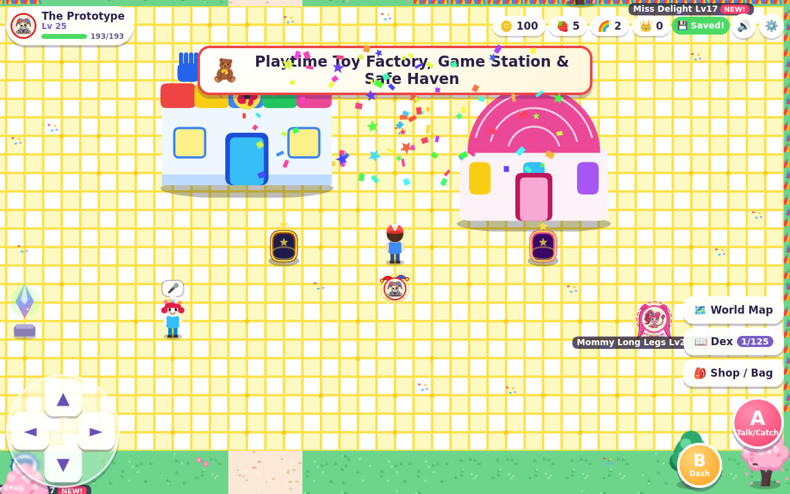

## 🎅🦕🦖🐈‍⬛ NEW: Poppy Playtime Plush & Wiki Drop Expansion (`#126–#133`, 133 Critters Total!)

Inspired by [`smiling-critters-assets#1`](https://github.com/kunruiw1991/smiling-critters-assets/pull/1) (`#855–#893`), **8 brand-new Poppy Playtime characters & plush editions** have arrived across Sunshine Village, Frostberry Glacier, Playtime Toy Factory, and Nightmare Playcare:

- `#126` 🎅 **Holiday Huggy Wuggy** (`★ Rare` *Frost* — *Festive Gift Toss*, recruitable right in **Sunshine Village** + guaranteed spawn at Playtime Factory Holiday Plaza & wild in Zone 7 / Zone 20!)
- `#127` 😁 **Smiling Huggy Wuggy** (*Pop* — *Mega Smile Beam*, wild in Zone 20 & Sub-Map #27/#28)
- `#128` 😈 **Scary Huggy Wuggy** (*Demon* — *Goofy Chomp Grin*, wild in Zone 20, Zone 21 & Sub-Map #27)
- `#129` 📺 **Nightmare Huggy Wuggy** (`★ Rare` *Demon* — *TV Static Pounce*, guaranteed spawn at Playcare Nightmare TV Courtyard + wild in Zone 21/22 & Sub-Map #30)
- `#130` 🦕 **Bron the Dinosaur** (*Leaf* — *Dino Tail Wag*, recruitable right in **Safe Haven (Zone 20)** + wild in Zone 20 & Sub-Map #27/#28)
- `#131` 🦖 **Bigger Body Bron** (`👑 Legendary` *Sun* — *Titan Bronto Stomp*, guaranteed spawn at Bron's Safe Haven Dino Paddock + rare in Zone 22 & Sub-Map #28)
- `#132` 🐈‍⬛ **Monster CatNap** (`★ Rare` *Moon* — *Long-Leg Moon Pounce*, guaranteed spawn at Playcare Monster CatNap Arch + wild in Zone 21 & Sub-Map #29/#30)
- `#133` 🌙 **Plush CatNap** (*Moon* — *Crescent Zipper Nap*, wild in Zone 20, Zone 21 & Sub-Map #29/#30)

## 🦾🎀🌙🔥 Poppy Playtime, Nightmare Smiling Critters & *Verity vs. Prototype: The Last Stand* Expansion!

| 🏭 Playtime Factory & Mommy's Game Station | 🌙 Nightmare Playcare & Nightmare CatNap | 🦾 The Prototype's Citadel & Infernotype | 🔥 Boss Battle: Prototype vs. Infernotype! |
|---|---|---|---|
|  | 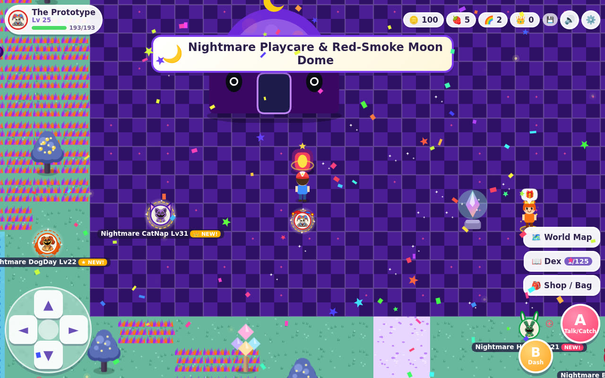 | 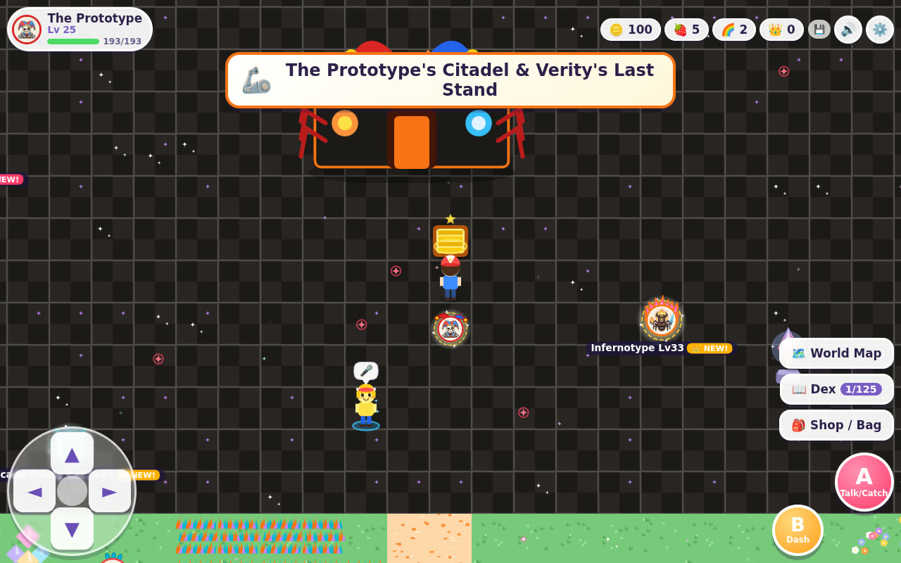 | 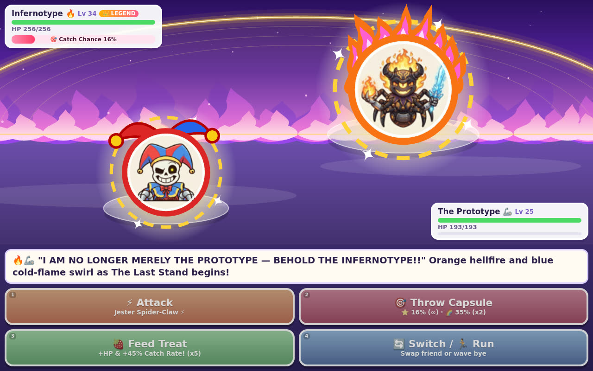 |

- **9 Starters on the Title Screen**: Pick **DogDay ☀️**, **CatNap 🌙**, **Hoppy Hopscotch ⚡**, **Mikey 🐢**, **JJ 🌊**, **Carrie 🐱**, **Huggy Wuggy 🧸**, **Poppy 🎀**, or **The Prototype 🦾** right on the Title Screen — and talk to **The Prototype**, **Poppy**, **Huggy Wuggy**, and **Kissy Missy** right inside **Sunshine Village (Zone 1)** to recruit all four onto your team with free Master & Rainbow Capsules!
- **30 Total Poppy Playtime, Nightmare Smiling Critters & *Verity vs. Prototype* Characters** (`#13` **Huggy Wuggy** 🧸, plus 29 brand-new Critters `#97–#125`):
  - **Poppy Playtime & Game Station (`#97–#106`)**:
    - `#97` 🎀 **Poppy** (*Star* — *Porcelain Ribbon Beam*)
    - `#98` 💗 **Kissy Missy** (*Pop* — *Pink Fuzzy Heart-Hug*)
    - `#99` 🕷️ **Mommy Long Legs** (`★ Rare` *Pop* — *Elastic Web Whiplash*)
    - `#100` 🥁 **Bunzo Bunny** (*Thunder* — *Cymbal Rhythm Crash*)
    - `#101` 🐛 **PJ Pug-a-Pillar** (*Leaf* — *Caterpillar Wiggle Dash*)
    - `#102` 📦 **Boxy Boo** (*Thunder* — *Spring-Box Pop*)
    - `#103` 📏 **Miss Delight** (*Spirit* — *Ruler Chalk-Beam*)
    - `#104` 🎩 **Doey the Doughman** (`★ Rare` *Rainbow* — *Triple-Dough Shield Slam*)
    - `#105` 🧶 **Yarnaby** (*Sun* — *Rainbow Yarn Roar*)
    - `#106` 🎹 **Pianosaurus** (*Leaf* — *Dino Key-Chord Stomp*)
  - **All 8 Bigger Bodies / Nightmare Smiling Critters (`#107–#114`)**:
    - `#107` 🌙 **Nightmare CatNap** (`👑 Legendary` *Moon* — *Red-Smoke Dream Nebula*)
    - `#108` ☀️ **Nightmare DogDay** (`★ Rare` *Sun* — *Solar Belt Reckoning*)
    - `#109` ⚡ **Nightmare Hoppy** (*Thunder* — *Monster Volt-Bound*)
    - `#110` ❤️ **Nightmare Bobby** (*Pop* — *Crimson Heart Embrace*)
    - `#111` 🌈 **Nightmare CraftyCorn** (*Rainbow* — *Phantom Prism Horn*)
    - `#112` 🍎 **Nightmare PickyPiggy** (*Leaf* — *Mega Apple-Chomp*)
    - `#113` 💡 **Nightmare Bubba** (*Ice* — *Mind-Storm Frost Pulse*)
    - `#114` ⭐ **Nightmare KickinChicken** (*Golden* — *Blazing Comet Kick*)
  - ***Verity vs. Prototype: The Last Stand* Heroes, Evolutions & Bosses (`#115–#125`)**:
    - `#115` 🦾 **The Prototype** (`👑 Legendary` *Galaxy* — *Jester Spider-Claw*, Experiment 1006 in his split red/blue jester hat & 6-legged arachnid chassis!)
    - `#116` 💙 **Verity** (`★ Rare` *Star* — *Radiant Truth Pulse*)
    - `#117` 💜 **Lily Lovebraids** (*Spirit* — *Prehensile Braid Whip*)
    - `#118` 🪵 **Chum Chompkins** (*Leaf* — *Tree-Chompkins Timber*)
    - `#119` 🧩 **Giblet** (*Star* — *Patchwork Gear Toss*)
    - `#120` 🦸 **Rory Redcape** (`★ Rare` *Golden* — *Lollipop Cape Slash*)
    - `#121` 👶 **Prototype Jr.** (`★ Rare` *Star* — *Baby Jester Skitter*)
    - `#122` 💧 **Cascade Candy Cat** (`★ Rare` *Water* — *Bubble Hydro Pump*)
    - `#123` 🌌 **Cosmic Luna Lovebraids** (`★ Rare` *Galaxy* — *Star-Braid Supernova*)
    - `#124` 📺 **Dr. Harley Sawyer** (`★ Rare` *Thunder* — *Omni-Eye TV Overload*)
    - `#125` 🔥 **Infernotype** (`👑 Legendary` *Sun* — *Molten & Cold-Flame Nova*)
- **3 New Playtime Overworld Lands (`Zones 20..22`, `rows 286..341`) + 6 New Playtime Sub-Maps (`submap_27`..`submap_32`)**:
  - **Zone 20: 🏭 Playtime Factory & Game Station** — Playtime Co. Toy Factory, Mommy Long Legs' Game Station Dome, and the healing **Doey's Safe Haven Lounge** 🎩 (`submap_27`: *Playtime GrabPack Assembly Hall*, `submap_28`: *Mommy Long Legs' Game Station Arena*).
  - **Zone 21: 🌙 Nightmare Playcare Dome** — Playcare Underground Dome & Statue Plaza and the Red-Smoke Home Sweet Home Sanctuary (`submap_29`: *Playcare Playhouse & Sun-Belt Sanctum*, `submap_30`: *Red-Smoke Moon Cathedral*).
  - **Zone 22: 🔥 The Prototype's Last Stand Citadel** — Infernotype's Blast-Furnace Citadel, Dr. Sawyer's Cyber-TV Lab, and the healing **Lily Lovebraids' Lavender Tea Dollhouse** 💜 (`submap_31`: *Dr. Sawyer's Cyber-Destroyer Lair*, `submap_32`: *Infernotype's Blast-Furnace & God-Stone Sanctum*).

## 🐢🌊🐱 NEW: JJ, Mikey, Carrie & the Maizen Show Expansion (18 Maizen Characters + 3 Maizen Lands + 6 Maizen Dungeons!)

- **6 Starters on the Title Screen**: Pick **DogDay ☀️**, **CatNap 🌙**, **Hoppy Hopscotch ⚡**, **Mikey 🐢**, **JJ 🌊**, or **Carrie 🐱** right on the Title Screen — and talk to **Mikey**, **JJ**, and **Carrie** right inside **Sunshine Village (Zone 1)** to recruit all three onto your team immediately!
- **18 Total Maizen Show Characters in the CritterDex** (`#09` **Mikey** 🐢, `#10` **JJ** 🌊, plus 16 brand-new Maizen characters `#81–#96`):
  - `#81` 🐱 **Carrie** (*Star* — *Cat-Hoodie Hug*)
  - `#82` 💎 **Pro Diamond JJ** (`★ Rare` *Thunder* — *Diamond Sword Slash*)
  - `#83` 🪨 **Noob Dirt Mikey** (`★ Rare` *Leaf* — *Mega Dirt Block Toss*)
  - `#84` 🍔 **Burger Chef JJ** (*Sun* — *Golden Burger Flip*)
  - `#85` 🍟 **Crispy Fries Mikey** (*Pop* — *Super Fry Rain*)
  - `#86` 🐕 **Bolt the Pet Wolf** (*Water* — *Loyal Wolf Pounce*)
  - `#87` 🍌 **Banana Cat** (*Rainbow* — *Happy Banana Boogie*)
  - `#88` 🚓 **Officer Chief** (*Thunder* — *Siren Flash Dash*)
  - `#89` 🦹 **Sneaky Robber** (*Moon* — *Money Bag Boomerang*)
  - `#90` 🧪 **Dr. Craft** (*Spirit* — *Rainbow Potion Splash*)
  - `#91` 🤖 **Redstone Security Golem** (*Golden* — *Laser Guard Beam*)
  - `#92` 🐢 **Super Mutant Mikey** (`★ Rare` *Leaf* — *Giant Shell Slam*)
  - `#93` 💻 **Masked Glitch Hacker** (`★ Rare` *Galaxy* — *Command Block Beam*)
  - `#94` ⚡ **Cursed Herobrine** (`★ Rare` *Thunder* — *Obsidian Lightning*)
  - `#95` 👑 **King Golden JJ** (`👑 Legendary` *Golden* — *100-Million Crown Beam*)
  - `#96` 🌌 **Ender Dragon Mikey** (`👑 Legendary` *Galaxy* — *Ender Burger Nova*)
- **3 New Maizen Overworld Lands (`Zones 17..19`, `rows 230..285`) + 6 New Maizen Sub-Maps (`submap_21`..`submap_26`)**:
  - **Zone 17: 🐢 JJ & Mikey's Security Mansion & Burger Blvd** — 100-Layer Redstone Security Mansion, Mikey's Noob Dirt House, and the healing **Noob vs Pro Burger & Fries Diner** 🍔 (`submap_21`: *JJ & Mikey's 100-Layer Security Bunker*, `submap_22`: *Noob vs Pro Burger Tycoon Kitchen*).
  - **Zone 18: 🧪 Maizen Bank Vault & Dr. Craft's Science Lab** — Maizen City Diamond Bank Vault and the healing **Dr. Craft's Giant Potion & Portal Lab** 🧪 (`submap_23`: *Maizen Laser Bank Vault & Escape Tunnel*, `submap_24`: *Dr. Craft's Giant Potion & Portal Lab*).
  - **Zone 19: 👑 Maizen Skyblock, Hacker Arena & Herobrine Keep** — 100-Million Golden Throne & Ender Dragon Sanctum, Hacker's Command-Block Glitch Arena, and Herobrine Obsidian Shrine (`submap_25`: *Hacker's Command-Block Glitch Arena*, `submap_26`: *Maizen Skyblock Dragon & Golden Throne Sanctum*).

## 🚪🏰 32 Enterable Embedded Small Maps Across All 22 Regions!

| 🏡 Sunshine Cozy Village Hall (`submap_01`) | 🐚 Sea-Bottom Coral City (`submap_04`) | 🎤 Honmoon Backstage Idol Lounge (`submap_10`) | 🔥 Gwi-Ma's Underworld Sanctum (`submap_11`) |
|---|---|---|---|
| 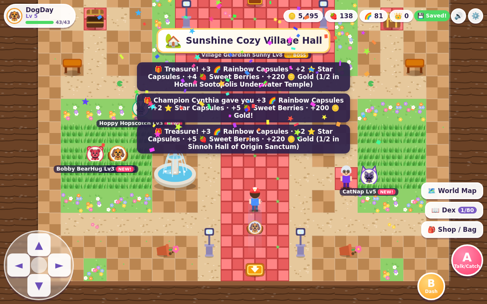 | 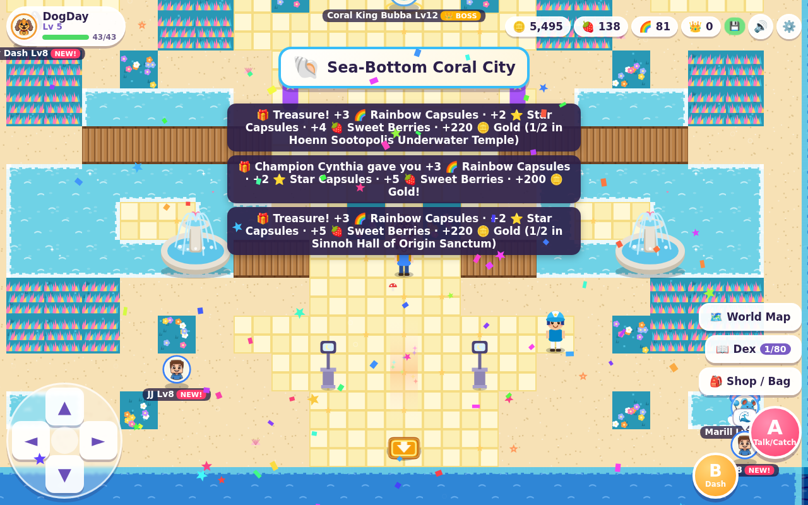 | 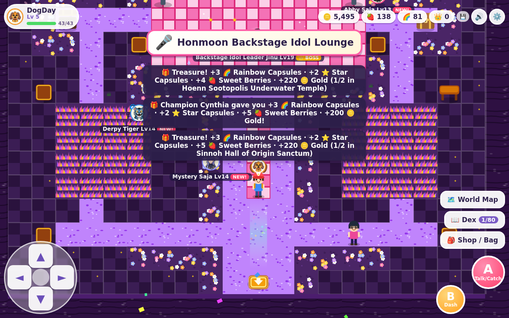 | 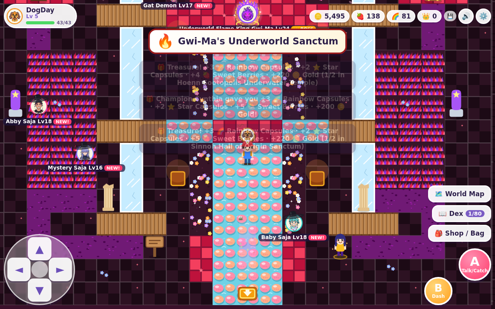 |
| **🧬 Kanto Cerulean Cave (`submap_15`)** | **✨ Sinnoh Hall of Origin Sanctum (`submap_20`)** | **⚔️ Standing Boss / Guardian Battle (Arceus)** | **🗺️ World Map with All 20 Sub-Map Pins** |
| 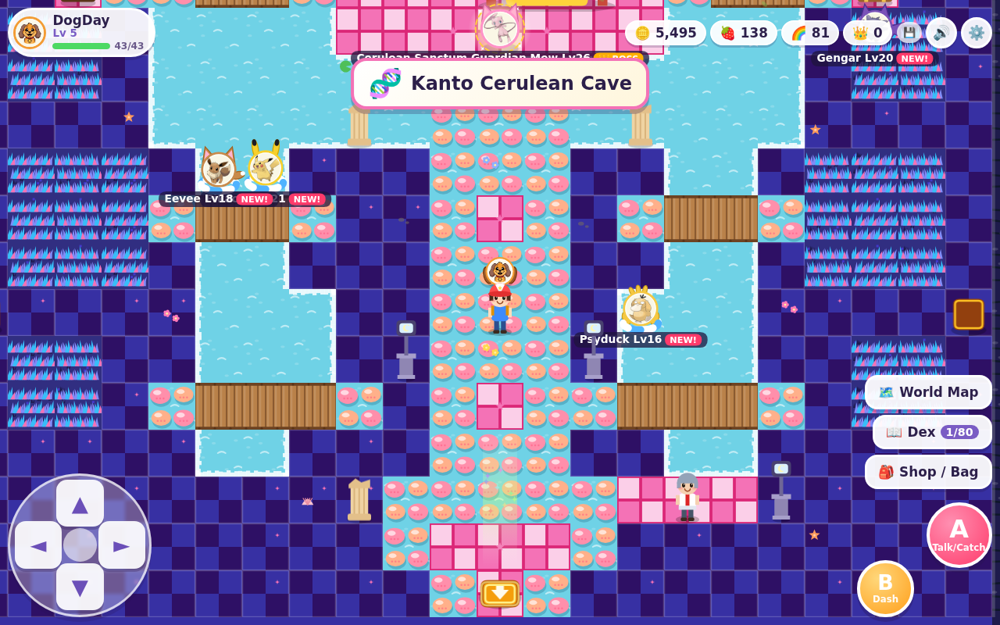 | 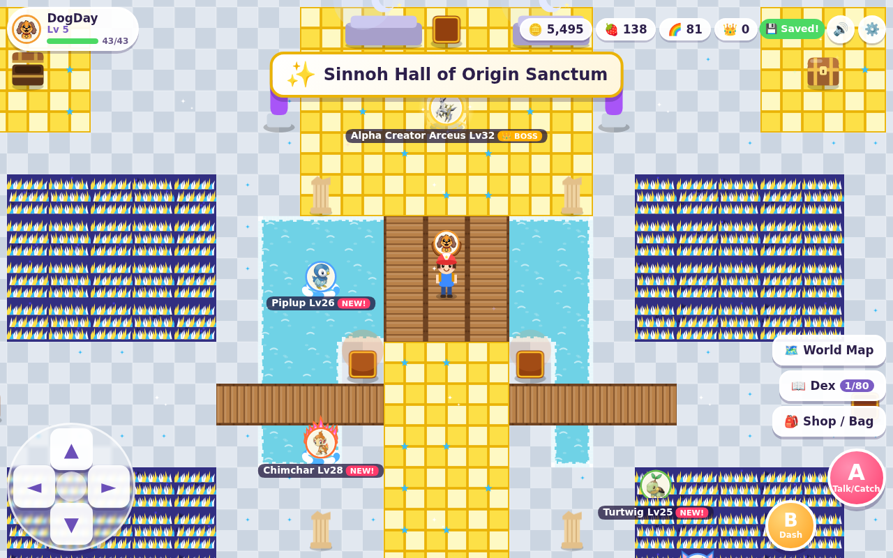 | 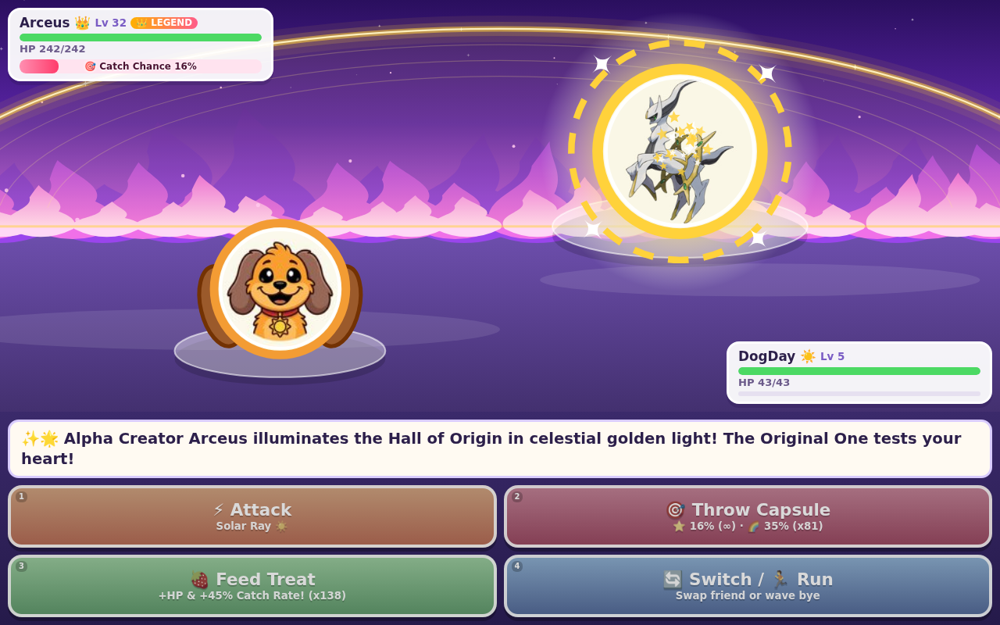 | 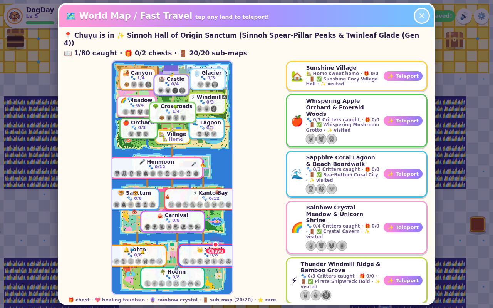 |

Every region across the `120 × 342` overworld features interactive **Sub-Map Entrances** (`🚪` doors, glowing caves, whirlpools, hatches, pyramid tombs, ladders, neon doors, underworld rifts, bathhouse curtains, temple stairs, GrabPack doors, Playcare cathedrals, and blast-furnace citadels). Walk onto an entrance, tap it, or press `A` (`Enter` / `Space` / `Z`) to step inside—and step onto the interior exit mat to return to the exact overworld entrance tile!

- **32 Self-Contained Interior Maps (`20 × 16` to `26 × 20` tiles)** with custom color palettes, procedural furniture & interactive props, **64 interior treasure chests**, **32 friendly Host NPCs** who bestow a one-time gift, roaming thematic wild Critters, and **32 standing Boss / Guardian encounters** with custom battle intros and victory blessings!
- **100% Reachability & Save Persistence**: Verified programmatically via `World.audit()` (`repairs === 0`, `unreachable.length === 0`) and `World.auditSubmaps()` (`count === 32`, `ok === true`, `unreachable.length === 0`), with full mid-dungeon save/reload persistence in `critterQuestRPG_v1`.

| # | Sub-Map ID | Name & Emoji | Zone | Overworld Entrance `(x, y)` | Size `W × H` | Host NPC & Gift | Wild Critters | Standing Boss / Guardian |
| :-: | :--- | :--- | :-: | :-: | :-: | :--- | :--- | :--- |
| 1 | `submap_01` | 🏡 **Sunshine Cozy Village Hall** | Zone 1 | `(60, 67)` | `20 × 16` | **Elder Sunny** (`3 🍓, 2 ⭐, 50 🪙`) | DogDay, CatNap, Hoppy, Bobby | **Village Guardian Sunny** (`sunny`, Lv 8) |
| 2 | `submap_02` | 🍄 **Whispering Mushroom Grotto** | Zone 2 | `(16, 78)` | `22 × 16` | **Herbalist Fern** (`4 🍓, 1 🌈, 60 🪙`) | PickyPiggy, Bobby, Mikey, Poppy | **Grotto Guardian Mikey** (`mikey`, Lv 10) |
| 3 | `submap_03` | 💎 **Crystal Cavern** | Zone 4 | `(17, 37)` | `22 × 18` | **Crystal Sage Lyra** (`2 🌈, 2 ⭐, 80 🪙`) | CraftyCorn, Bobby, Poppy, Prism | **Prism Guardian CraftyCorn** (`prism`, Lv 13) |
| 4 | `submap_04` | 🐚 **Sea-Bottom Coral City** | Zone 3 | `(98, 67)` | `24 × 18` | **Coral Diver Marina** (`2 🌈, 3 🍓, 75 🪙`) | JJ, Poppy, Bubba, Marill | **Coral King Bubba** (`bubba`, Lv 12) |
| 5 | `submap_05` | 🏴‍☠️ **Pirate Shipwreck Hold** | Zone 5 | `(112, 35)` | `24 × 16` | **First Mate Barnaby** (`2 🌈, 2 ⭐, 110 🪙`) | Hoppy, KickinChicken, JJ, Thunderbolt | **Storm-Captain Thunderbolt** (`thunderbolt`, Lv 14) |
| 6 | `submap_06` | 🏺 **Pyramid Pharaoh Tomb** | Zone 6 | `(15, 11)` | `24 × 18` | **Explorer Nile** (`2 🌈, 3 ⭐, 130 🪙`) | DogDay, SunnyFox, KickinChicken, Superstar | **Pharaoh Guardian Superstar** (`superstar`, Lv 16) |
| 7 | `submap_07` | ❄️ **Glacier Ice Cavern** | Zone 7 | `(84, 13)` | `22 × 18` | **Skier Yukiko** (`2 🌈, 4 🍓, 120 🪙`) | Bubba, Huggy Wuggy, Aurora | **Aurora Guardian Fluff** (`aurora`, Lv 18) |
| 8 | `submap_08` | 🌙 **Starlight Moon Dungeon** | Zone 8 | `(59, 12)` | `24 × 18` | **Astrologer Selene** (`3 🌈, 3 ⭐, 150 🪙`) | CatNap, LunaBat, Galaxy, Solar | **Moon-Sanctum Guardian Galaxy** (`galaxy`, Lv 21) |
| 9 | `submap_09` | 🌳 **Crossroads Secret Treehouse** | Zone 9 | `(63, 45)` | `20 × 16` | **Scout Maple** (`2 🌈, 4 🍓, 100 🪙`) | DogDay, CatNap, Hoppy, Solar | **Canopy Guardian Solar** (`solar`, Lv 15) |
| 10 | `submap_10` | 🎤 **Honmoon Backstage Idol Lounge** | Zone 10 | `(81, 101)` | `22 × 16` | **Manager Bobby** (`3 🌈, 4 🍓, 150 🪙`) | Derpy, Sussie, Abby, Mystery, Romance, Jinu | **Backstage Idol Leader Jinu** (`jinu`, Lv 19) |
| 11 | `submap_11` | 🔥 **Gwi-Ma's Underworld Sanctum** | Zone 10 | `(90, 102)` | `24 × 18` | **Guardian Mentor Celine** (`1 👑, 3 🌈, 180 🪙`) | Gat Demon, Baby, Abby, Mystery, Jinu, Gwi-Ma | **Underworld Flame King Gwi-Ma** (`gwima`, Lv 24) |
| 12 | `submap_12` | 🐯 **Derpy's Secret Tiger Den** | Zone 11 | `(23, 130)` | `22 × 16` | **Minhwa Painter Seojun** (`3 🌈, 4 🍓, 140 🪙`) | Derpy, Sussie, Flight Dokkaebi, Jeoseung, Gat-Derpy | **Secret Den Guardian Gat-Derpy** (`gatderpy`, Lv 20) |
| 13 | `submap_13` | ♨️ **Bathhouse Steam Grotto** | Zone 11 | `(22, 148)` | `20 × 16` | **Bathhouse Auntie Bora** (`5 🍓, 2 🌈, 130 🪙`) | Water Demon, Derpy, Sussie, Jeoseung | **Steam-Spring Lord Water Demon** (`waterdemon`, Lv 19) |
| 14 | `submap_14` | 🎪 **Nightmare Funhouse Maze** | Zone 12 | `(55, 133)` | `24 × 18` | **Ringmaster Trick** (`3 🌈, 3 ⭐, 160 🪙`) | Baba, Icky, Rabie, Allister, Poe, Touille, Maggie | **Mirror-Maze Ringmaster Simon Smoke** (`simon`, Lv 22) |
| 15 | `submap_15` | 🧬 **Kanto Cerulean Cave** | Zone 13 | `(95, 155)` | `24 × 18` | **Professor Oak's Aide** (`1 👑, 3 🌈, 200 🪙`) | Pikachu, Eevee, Psyduck, Gengar, Snorlax, Mew | **Cerulean Sanctum Guardian Mew** (`mew`, Lv 26) |
| 16 | `submap_16` | 🌋 **Volcano Magma Chamber** | Zone 13 | `(104, 129)` | `22 × 18` | **Volcano Tamer Blaine** (`3 🌈, 3 ⭐, 180 🪙`) | Charmander, Pikachu, Meowth, Gengar, Charizard | **Magma Core Guardian Charizard** (`charizard`, Lv 24) |
| 17 | `submap_17` | 🌊 **Johto Whirl Islands Abyss** | Zone 14 | `(20, 185)` | `24 × 18` | **Tidal Sage Hiro** (`1 👑, 3 🌈, 220 🪙`) | Totodile, Marill, Umbreon, Suicune, Lugia | **Abyssal Roost Guardian Lugia** (`lugia`, Lv 28) |
| 18 | `submap_18` | 🔔 **Bell Tower Sacred Attic** | Zone 14 | `(30, 188)` | `22 × 18` | **Bell Keeper Eusine** (`3 🌈, 4 ⭐, 200 🪙`) | Chikorita, Cyndaquil, Togepi, Umbreon, Suicune | **Sacred Bell Guardian Suicune** (`suicune`, Lv 27) |
| 19 | `submap_19` | 🏛️ **Hoenn Sootopolis Underwater Temple** | Zone 15 | `(64, 204)` | `24 × 18` | **Champion Steven** (`1 👑, 4 🌈, 250 🪙`) | Treecko, Torchic, Mudkip, Gardevoir, Milotic, Absol | **Sky-Temple Guardian Rayquaza** (`rayquaza`, Lv 30) |
| 20 | `submap_20` | ✨ **Sinnoh Hall of Origin Sanctum** | Zone 16 | `(103, 184)` | `26 × 20` | **Champion Cynthia** (`2 👑, 5 🌈, 300 🪙`) | Turtwig, Chimchar, Piplup, Shinx, Buneary, Lucario, Garchomp | **Alpha Creator Arceus** (`arceus`, Lv 32) |
| 21 | `submap_21` | 🛡️ **JJ & Mikey's 100-Layer Security Bunker** | Zone 17 | `(25, 245)` | `22 × 16` | **Security Engineer JJ** (`3 🌈, 4 🍓, 180 🪙`) | Pro Diamond JJ, Mikey, JJ, Carrie, Bolt the Wolf, Redstone Golem | **Chief Redstone Security Golem** (`redstonegolem`, Lv 23) |
| 22 | `submap_22` | 🍔 **Noob vs Pro Burger Tycoon Kitchen** | Zone 17 | `(25, 263)` | `22 × 16` | **Head Chef Carrie** (`5 🍓, 3 🌈, 175 🪙`) | Burger Chef JJ, Crispy Fries Mikey, Noob Dirt Mikey, Carrie, Banana Cat | **Master Burger Chef JJ** (`burgerjj`, Lv 24) |
| 23 | `submap_23` | 🏦 **Maizen Laser Bank Vault & Escape Tunnel** | Zone 18 | `(56, 245)` | `24 × 18` | **Police Chief** (`3 🌈, 4 🍓, 210 🪙`) | Officer Chief, Sneaky Robber, Bolt the Wolf, Banana Cat, Noob Mikey | **Mastermind Sneaky Robber** (`maizenrobber`, Lv 26) |
| 24 | `submap_24` | 🧪 **Dr. Craft's Giant Potion & Portal Lab** | Zone 18 | `(64, 263)` | `24 × 18` | **Dr. Craft** (`4 🌈, 4 🍓, 220 🪙`) | Dr. Craft, Super Mutant Mikey, Redstone Golem, Mikey, JJ, Carrie | **Titan Super Mutant Mikey** (`mutantmikey`, Lv 27) |
| 25 | `submap_25` | 💻 **Hacker's Command-Block Glitch Arena** | Zone 19 | `(89, 263)` | `24 × 18` | **White-Hat Pro JJ** (`1 👑, 3 🌈, 250 🪙`) | Masked Hacker, Herobrine, Pro Diamond JJ, Noob Mikey, Redstone Golem | **Grand Masked Glitch Hacker** (`maizenhacker`, Lv 29) |
| 26 | `submap_26` | 👑 **Maizen Skyblock Dragon & Golden Throne Sanctum** | Zone 19 | `(96, 244)` | `26 × 20` | **Skyblock Queen Carrie** (`2 👑, 5 🌈, 350 🪙`) | King Golden JJ, Ender Dragon Mikey, Herobrine, Masked Hacker, Pro JJ, Mutant Mikey | **Skyblock Sovereign Ender Dragon Mikey** (`dragonmikey`, Lv 32) |
| 27 | `submap_27` | 🏭 **Playtime GrabPack Assembly Hall** | Zone 20 | `(25, 300)` | `24 × 18` | **Poppy Doll** (`3 🌈, 4 🍓, 220 🪙`) | Poppy, Kissy Missy, Bunzo Bunny, PJ Pug-a-Pillar, Boxy Boo, Yarnaby | **Factory Mascot Huggy Wuggy** (`huggy`, Lv 25) |
| 28 | `submap_28` | 🕷️ **Mommy Long Legs' Game Station Arena** | Zone 20 | `(32, 300)` | `24 × 18` | **Doey the Doughman** (`4 🌈, 4 🍓, 240 🪙`) | Bunzo Bunny, PJ Pug-a-Pillar, Boxy Boo, Doey, Yarnaby, Pianosaurus | **Game Station Hostess Mommy Long Legs** (`mommylonglegs`, Lv 27) |
| 29 | `submap_29` | ☀️ **Playcare Playhouse & Sun-Belt Sanctum** | Zone 21 | `(55, 319)` | `24 × 18` | **Playcare Helper Ollie** (`4 🌈, 5 🍓, 260 🪙`) | Nightmare Hoppy, Nightmare Bobby, Nightmare CraftyCorn, Nightmare PickyPiggy, Nightmare Bubba, Nightmare KickinChicken | **Playhouse Leader Nightmare DogDay** (`nmdogday`, Lv 28) |
| 30 | `submap_30` | 🌙 **Red-Smoke Moon Cathedral** | Zone 21 | `(57, 300)` | `26 × 20` | **Teacher Miss Delight** (`1 👑, 4 🌈, 300 🪙`) | All 7 Nightmare Smiling Critters + Miss Delight | **Red-Smoke Guardian Nightmare CatNap** (`nmcatnap`, Lv 30) |
| 31 | `submap_31` | 📺 **Dr. Sawyer's Cyber-Destroyer Lair** | Zone 22 | `(101, 319)` | `26 × 20` | **Rory Redcape** (`1 👑, 4 🌈, 320 🪙`) | Lily Lovebraids, Chum Chompkins, Giblet, Rory Redcape, Cascade Candy Cat, Cosmic Luna Lovebraids | **Omni-Eye Overseer Dr. Harley Sawyer** (`drsawyer`, Lv 31) |
| 32 | `submap_32` | 🔥 **Infernotype's Blast-Furnace & God-Stone Sanctum** | Zone 22 | `(96, 299)` | `26 × 20` | **Player & Helper Verity** (`2 👑, 5 🌈, 400 🪙`) | The Prototype, Verity, Prototype Jr., Cascade Candy Cat, Cosmic Luna Lovebraids, Rory Redcape | **Blast-Furnace Reborn Infernotype** (`infernotype`, Lv 34) |

---

## 🌟 The Grand Pokémon Continent Expansion — Generations 2, 3 & 4 (Johto 🔔, Hoenn 🌴 & Sinnoh 👑)

| 🔔 Johto Bell-Tower Groves (Gen 2) | 🌴 Hoenn Sky-Pillar Tropics (Gen 3) | 👑 Sinnoh Spear-Pillar Peaks (Gen 4) |
|---|---|---|
| 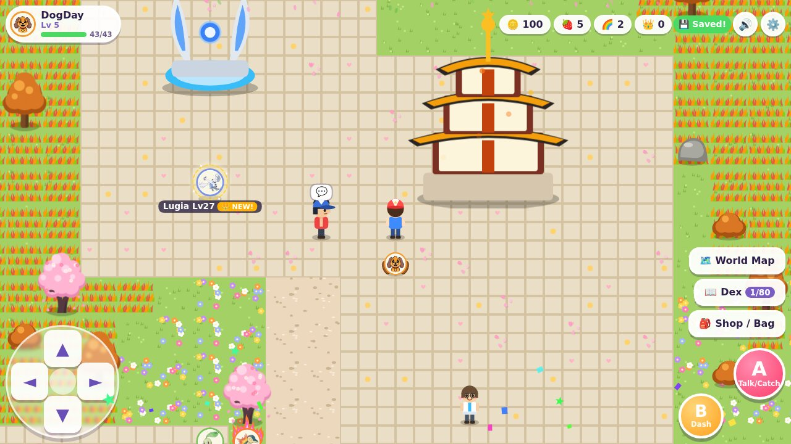 | 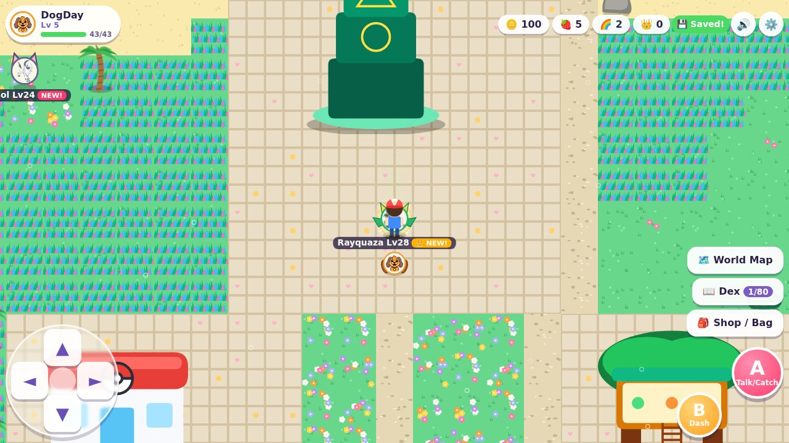 | 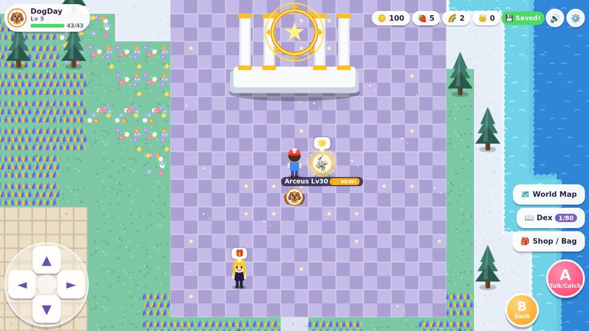 |

Three grand sea bridges lead south from the Southern Continent (`x = 24`, `x = 64`, `x = 90`) into the **Grand Pokémon Continent** (`rows 174..229`), bringing **24 iconic Pokémon from Generations 2, 3 & 4 (`#57–#80`)**:

### 1. 🔔 Johto Bell-Tower Groves & Ecruteak Lake (Zone 14 — Generation 2)
- **Landmarks & Friends**: **Ecruteak Bell Tower** 🔔 (golden-roofed 3-tier pagoda), **Whirl Island Lugia Roost** 🌊, **Johto Pokémon Center** ❤️, **Kurt's Apricorn Workshop** 🌰 (Kurt gifts `4 🌈 + 5 🍓`), **Professor Elm**, and **Ethan**.
- **8 Generation 2 (Johto) Pokémon (`#57–#64`)**:
  - `#57` 🍃 **Chikorita** (*Leaf* — *Magical Leaf*)
  - `#58` 🔥 **Cyndaquil** (*Sun* — *Flame Wheel*)
  - `#59` 🐊 **Totodile** (*Water* — *Aqua Bite*)
  - `#60` 🥚 **Togepi** (*Star* — *Metronome Sparkle*)
  - `#61` 🫧 **Marill** (*Water* — *Aqua Tail Bounce*)
  - `#62` 🌙 **Umbreon** (*Moon* — *Moonlight Pulse*)
  - `#63` 💎 **Suicune** (`★ Rare` *Ice* — *Aurora Beam*, waits at the Ecruteak Crystal Spring)
  - `#64` 🪶 **Lugia** (`👑 Legendary` *Galaxy* — *Aeroblast*, rests at Whirl Island Lugia Roost, Lv 27)

### 2. 🌴 Hoenn Sky-Pillar Tropics & Sootopolis Lagoon (Zone 15 — Generation 3)
- **Landmarks & Friends**: **Sky Pillar Tower** 🐉, **Hoenn Pokémon Center** ❤️, **Hoenn Secret Base Treehouse** 🌴, **Sootopolis Lagoon**, **Steven's Meteor Crater**, **Professor Birch**, **Champion Steven Stone** (gifts `200 🪙 + 3 🌈`), and **May**.
- **8 Generation 3 (Hoenn) Pokémon (`#65–#72`)**:
  - `#65` 🦎 **Treecko** (*Leaf* — *Leaf Blade*)
  - `#66` 🐥 **Torchic** (*Sun* — *Ember Peck*)
  - `#67` 💦 **Mudkip** (*Water* — *Muddy Splash*)
  - `#68` 💖 **Gardevoir** (*Rainbow* — *Dazzling Gleam*)
  - `#69` 🌈 **Milotic** (*Water* — *Hydro Rainbow*)
  - `#70` 🌙 **Absol** (*Moon* — *Night Slash*)
  - `#71` ⚡ **Metagross** (`★ Rare` *Thunder* — *Meteor Mash*, waits at Steven's Meteor Crater)
  - `#72` 🐉 **Rayquaza** (`👑 Legendary` *Galaxy* — *Dragon Ascent*, watches from Sky Pillar Summit, Lv 28)

### 3. 👑 Sinnoh Spear-Pillar Peaks & Twinleaf Glade (Zone 16 — Generation 4)
- **Landmarks & Friends**: **Spear Pillar Temple** 👑 (marble Hall of Origin with a spinning golden celestial wheel), **Sinnoh Pokémon Center** ❤️, **Professor Rowan's Sandgem Lab** 🔬, **Professor Rowan**, **Champion Cynthia** (gifts `3 🌈 + 1 👑 Master Star Capsule`), and **Dawn**.
- **8 Generation 4 (Sinnoh) Pokémon (`#73–#80`)**:
  - `#73` 🌱 **Turtwig** (*Leaf* — *Razor Leaf*)
  - `#74` 🔥 **Chimchar** (*Sun* — *Flame Spin*)
  - `#75` 🐧 **Piplup** (*Water* — *Bubble Peck*)
  - `#76` ⚡ **Shinx** (*Thunder* — *Spark Flash*)
  - `#77` 🎀 **Buneary** (*Pop* — *Dizzy Hop*)
  - `#78` 💠 **Lucario** (`★ Rare` *Spirit* — *Aura Sphere*, trains at the Aura Training Dojo)
  - `#79` 🦈 **Garchomp** (`★ Rare` *Golden* — *Dragon Rush*, waits at Cynthia's Champion Cliff)
  - `#80` 👑 **Arceus** (`👑 Legendary` *Galaxy* — *Judgment Star*, shines at Spear Pillar Temple, Lv 30)

---

## 🐯🎪⚡ The Southern Continent — Derpy's Minhwa Sanctum, Nightmare Critters Carnival & Kanto Classics Bay (Gen 1)

| 🐯 Derpy's Minhwa Sanctum | 🎪 Nightmare Critters Carnival | ⚡ Kanto Classics Bay |
|---|---|---|
| 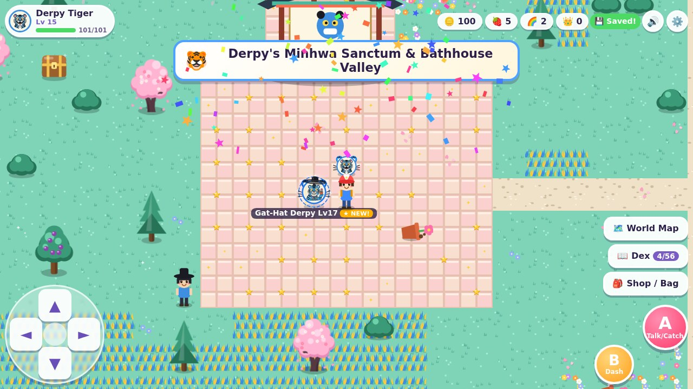 | 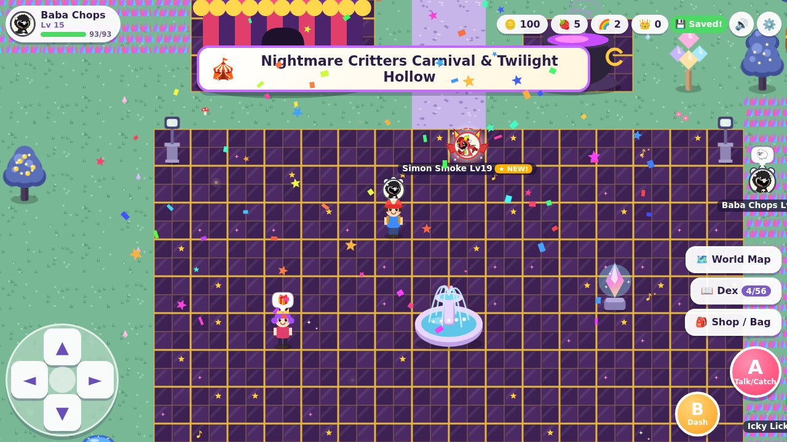 | 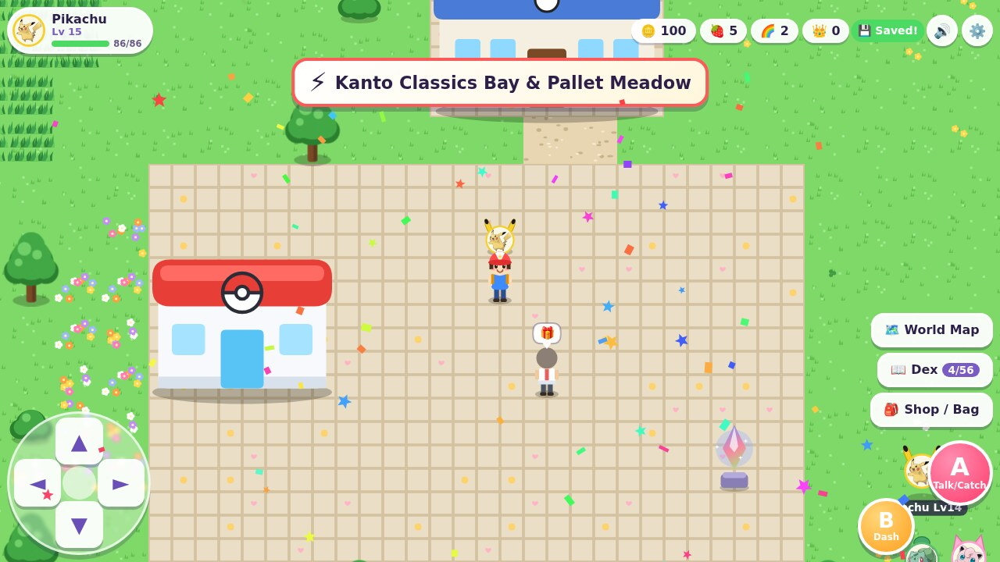 |

Three bridges lead south from **Honmoon Island** (`x = 34`, `x = 59`, `x = 90`) into the Southern Continent (`rows 118..173`):

### 1. 🐯 Derpy's Minhwa Sanctum & Bathhouse Valley (Zone 11)
- **🪴 Knocked-Over Flowerpots**: Just like in *KPop Demon Hunters*, Derpy Tiger cannot resist patting tipped-over flowerpots upright! Tap any knocked-over flowerpot (`🪴`) and Derpy Tiger's blue paw pats it upright (`+2 🍓 Sweet Berries · +25 🪙 Gold`).
- **Landmarks & Friends**: **Derpy's Tiger Pavilion**, **Jjimjilbang Bathhouse Springs** ♨️, **Healer Han's Tonic Clinic** (Healer Han gifts `5 🍓 + 2 🌈`), **Minhwa Painter Ji-ho**, and the **Soda Pop Idol Truck** 🥤.
- **4 More Demon Hunter Critters (`#33–#36`)**: `#33` 🎩 **Gat-Hat Derpy** (`★ Rare`), `#34` 💧 **Water Demon**, `#35` ✈️ **Flight Dokkaebi**, `#36` 🏮 **Jeoseung Saja**.

### 2. 🎪 Nightmare Critters Carnival & Twilight Hollow (Zone 12)
- **Landmarks & Friends**: **Nightmare Critters Carnival Tent** 🎪, **Dragon Smoke Cauldron** 🔥, **Sweet-Tooth Carnival Fountain** 💖, **Allister Gator's Swamp Pond**, bouncy trampoline pads, and **Ringleader Harper**.
- **All 8 Official Nightmare Critters (`#37–#44`)**: `#37` 🐑 **Baba Chops**, `#38` 🐸 **Icky Licky**, `#39` 🦇 **Rabie Baby**, `#40` 🐊 **Allister Gator**, `#41` 🐉 **Simon Smoke** (`★ Rare`), `#42` 🐦‍⬛ **Poe**, `#43` 🐀 **Touille**, `#44` 🦈 **Maggie Mako**.

### 3. ⚡ Kanto Classics Bay & Pallet Meadow (Zone 13 — Generation 1)
- **Landmarks & Friends**: **Pokémon Center** ❤️, **Professor Oak's Pallet Lab** (Professor Oak gifts `3 🌈 + 1 👑 Master Star Capsule`), **Ash**, **Misty**, **Brock**, **Snorlax Footbridge**, **Ember Volcano Peak**, and **Cerulean Mew Shrine**.
- **12 Iconic Original First-Generation Pokémon (`#45–#56`)**: `#45` ⚡ **Pikachu**, `#46` 🌱 **Bulbasaur**, `#47` 🔥 **Charmander**, `#48` 💦 **Squirtle**, `#49` 🎤 **Jigglypuff**, `#50` 🌟 **Eevee**, `#51` 🦆 **Psyduck**, `#52` 🪙 **Meowth**, `#53` 👻 **Gengar**, `#54` 😴 **Snorlax** (`★ Rare`), `#55` 🐉 **Charizard** (`★ Rare`), `#56` ✨ **Mew** (`👑 Legendary`).

---

## 🎤 Honmoon Island — the K-Pop Demon Hunters Expansion

| 🎤 Golden Honmoon Stage | 💜 Rumi joins the team! | 👹 Boss battle: Gwi-Ma |
|---|---|---|
| 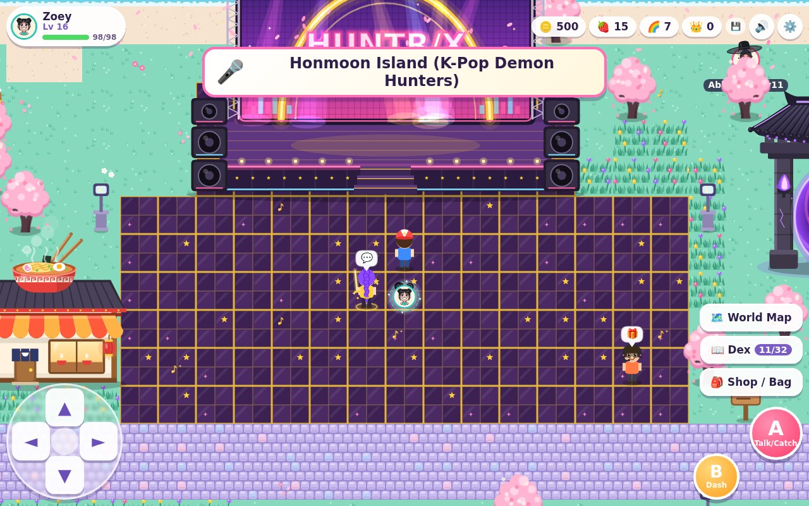 | 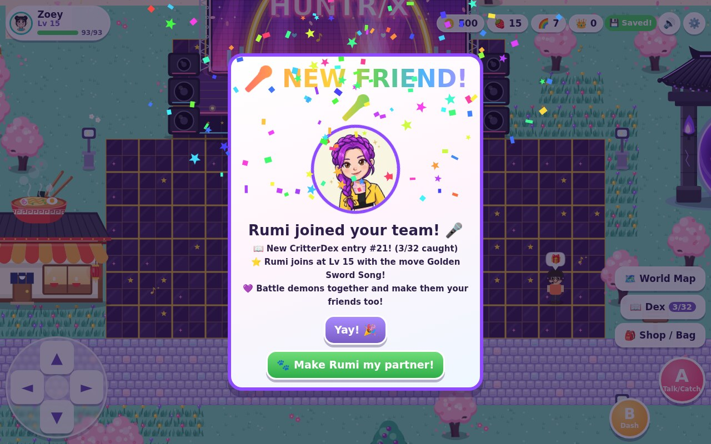 | 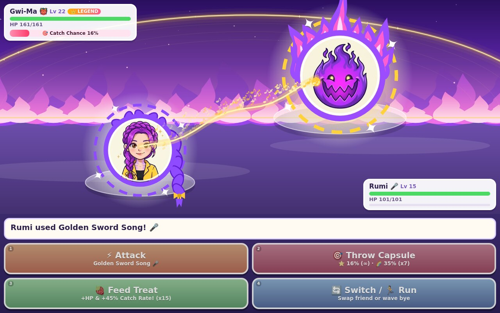 |

- **🌉 Golden Honmoon Bridge**: walk out of Sunshine Village's south gate (or tap **Honmoon** on the 🗺️ World Map) to cross the sea
  to Honmoon Island: a twilight K-pop city island with cherry blossoms 🌸, glowing lanterns, golden music notes ♪ and falling petals.
- **Landmarks**: the **Golden Honmoon Stage**, **N Seoul Tower** on Namsan Hill, **Zoey's favorite Ramen Shop** 🍜, the **Golden Honmoon Fountain**, **Celine's Hanok**, and the swirling purple **Demon Gate** 👹.
- **HUNTR/X join your team!** Say hi to **Rumi** 🎤 (at the stage), **Mira** 💃 (by N Seoul Tower) and **Zoey** 🎧 (at the ramen shop) — each hero **joins Chuyu's team at Lv 15**!
- **12 Honmoon Critters (`#21–#32`)**: **Rumi**, **Mira**, **Zoey**, **Derpy Tiger** 🐯, **Sussie** 🐦, **Jinu** 🦁 (`★ Rare`), **Abby Saja** 💪, **Mystery Saja** 🔮, **Romance Saja** 💘, **Baby Saja** 🧢, **Gat Demon** 😈, and **Gwi-Ma** 👹 (`👑 Legendary`).

| 🏡 Sunshine Village | 🌈 Crystal Meadow | ⚔️ Catching a rare Prism CraftyCorn |
|---|---|---|
| 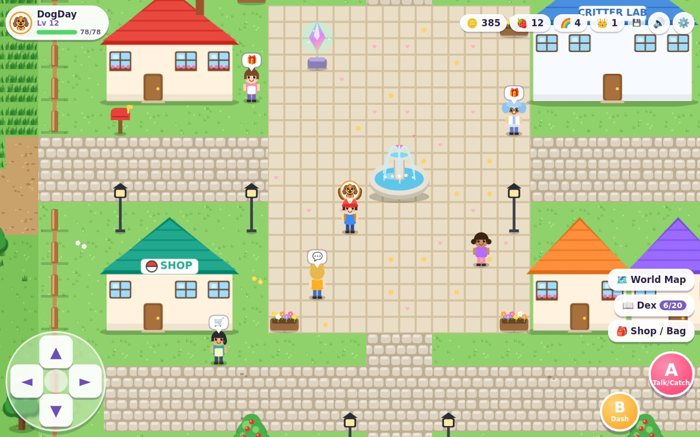 | 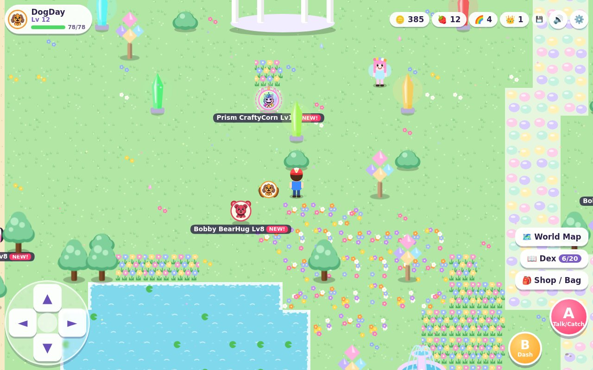 | 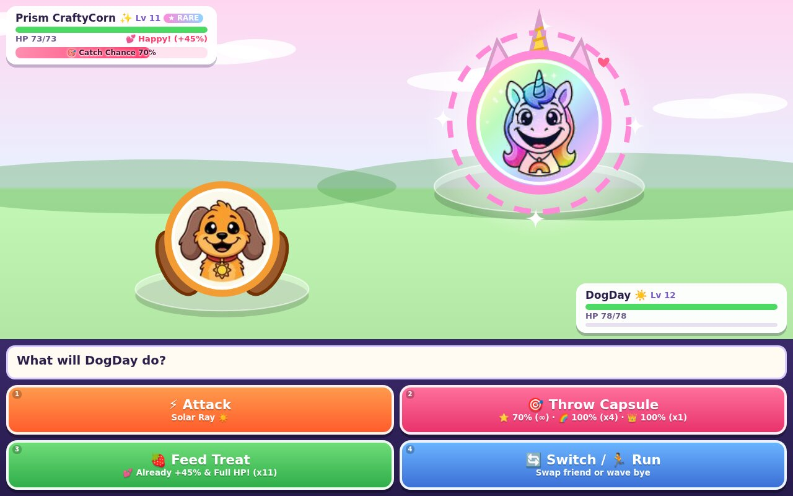 |
| **🗺️ World Map / Fast Travel (21 Lands)** | **📖 CritterDex (125 Critters)** | |
| 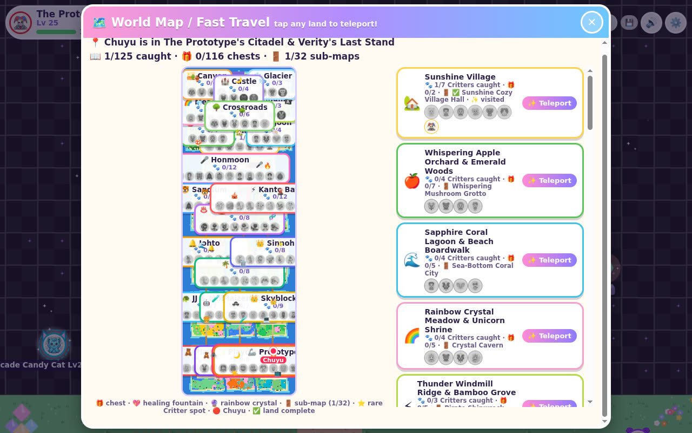 | 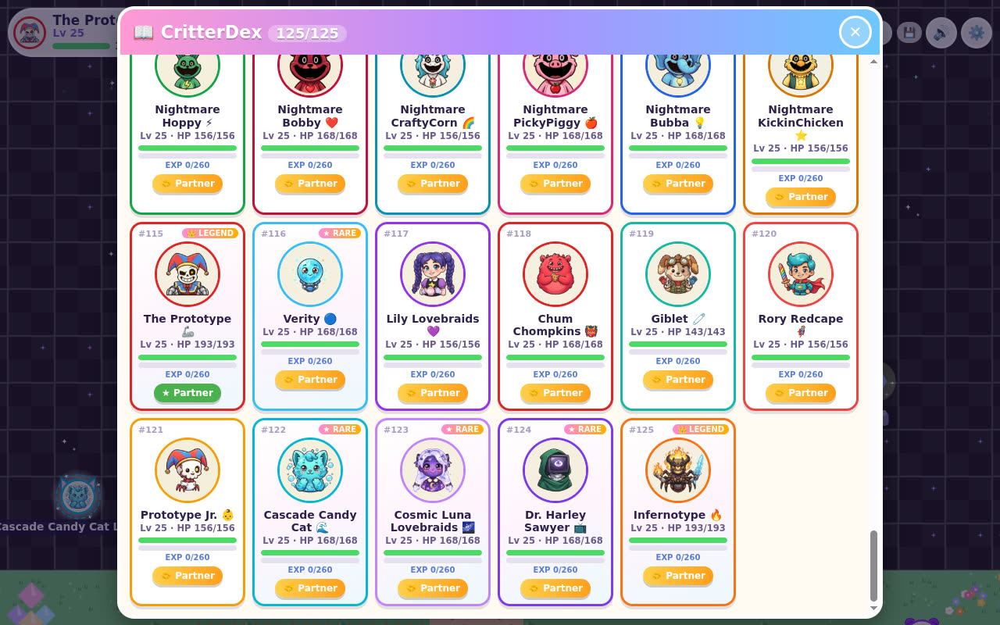 | |

---

## ✨ Highlights

- **Huge 120 × 342 world (41,040 tiles, 48 px tiles)**: Rainbow Island (`rows 0..89`), Honmoon Island (`rows 90..117`), the Southern Continent (`rows 118..173`), the Grand Pokémon Continent (`rows 174..229`), the Maizen Prank & Craft Continent (`rows 230..285`), and the Poppy Playtime, Nightmare Playcare & Prototype Continent (`rows 286..341`), generated deterministically. Every chest, flowerpot, tree, NPC, fountain, crystal and rare spot is verified reachable on foot (`World.audit().unreachable` is always `[]` and `repairs === 0`).
- **21 main lands + Rainbow Crossroads Park**, each with its own tile palette, landmarks, chiptune music, weather particles and Critters:

  | # | Region | Landmarks | Critters |
  |---|--------|-----------|----------|
  | 1 | 🏡 **Sunshine Village** | Chuyu's house, Professor Bubba's Lab, Shop, Healing Fountain, The Prototype 🦾, Poppy 🎀, Huggy Wuggy 🧸, Kissy Missy 💗, Mikey 🐢, JJ 🌊 & Carrie 🐱 | *(safe town)* |
  | 2 | 🍎 **Whispering Apple Orchard & Emerald Woods** | Apple rows, streams, bridges, fairy mushroom ring | PickyPiggy 🍎, Bobby BearHug ❤️, Mikey 🌿 |
  | 3 | 🌊 **Sapphire Coral Lagoon & Beach Boardwalk** | Golden beach, boardwalk, lighthouse pier, coral stepping stones | JJ 🌊, Poppy Dash 🌸, Bubba Bubbaphant 💡 |
  | 4 | 🌈 **Rainbow Crystal Meadow & Unicorn Shrine** | Pastel flower fields, crystal pillars, Unicorn Gazebo | CraftyCorn 🌈, Bobby ❤️, Poppy 🌸, ✨ **Prism CraftyCorn** |
  | 5 | ⚡ **Thunder Windmill Ridge & Bamboo Grove** | Spinning windmills, bamboo trail, trampoline pads, Lightning Shrine | Hoppy Hopscotch ⚡, KickinChicken ⭐, ⚡ **Thunderbolt Hoppy** |
  | 6 | 🏜️ **Golden Sunbaked Canyon & Oasis Ruins** | Great Pyramid, palm oasis, cactus trails, ruins | DogDay ☀️, SunnyFox 🦊, KickinChicken ⭐, 🌟 **Superstar KickinChicken** |
  | 7 | ❄️ **Frostberry Glacier & Aurora Hot Springs** | Snowy pines, frozen lake, aurora ice crystals, hot springs | Bubba 💡, Huggy Wuggy 🧸, ❄️ **Aurora Huggy** |
  | 8 | 🏰 **Starlight Lavender Sanctuary & Moon Castle** | Lavender rows, Starlight Moon Castle, Sun & Moon Altars | CatNap 🌙, LunaBat 🦇, 🌌 **Galaxy CatNap**, 👑 **Solar Crown DogDay** |
  | 9 | 🌳 **Rainbow Crossroads Park** (central hub) | Rainbow Lake with treasure island, signposts to every land | DogDay, CatNap, Hoppy, PickyPiggy |
  | 10 | 🎤 **Honmoon Island (K-Pop Demon Hunters)** | Golden Honmoon Stage, N Seoul Tower, Ramen Shop, Demon Gate | Rumi, Mira, Zoey, Derpy Tiger, Sussie, Gat Demon, Saja Boys, ★ **Jinu**, 👑 **Gwi-Ma** |
  | 11 | 🐯 **Derpy's Minhwa Sanctum & Bathhouse Valley** | Derpy's Tiger Pavilion, Tipped Flowerpots 🪴, Jjimjilbang Bathhouse ♨️, Healer Han's Clinic, Soda Pop Truck | Derpy Tiger, Sussie, Water Demon 💧, Flight Dokkaebi ✈️, Jeoseung Saja 🏮, ★ **Gat-Hat Derpy** 🎩 |
  | 12 | 🎪 **Nightmare Critters Carnival & Twilight Hollow** | Carnival Tent 🎪, Dragon Smoke Cauldron 🔥, Gator Swamp, Sweet-Tooth Fountain | Baba Chops 🐑, Icky Licky 🐸, Rabie Baby 🦇, Allister Gator 🐊, Poe 🐦‍⬛, Touille 🐀, Maggie Mako 🦈, ★ **Simon Smoke** 🐉 |
  | 13 | ⚡ **Kanto Classics Bay & Pallet Meadow (Gen 1)** | Pokémon Center ❤️, Professor Oak's Lab, Snorlax Bridge, Ember Volcano, Cerulean Mew Shrine | Pikachu ⚡, Bulbasaur 🌱, Charmander 🔥, Squirtle 💦, Jigglypuff 🎤, Eevee 🌟, Psyduck 🦆, Meowth 🪙, Gengar 👻, ★ **Snorlax**, ★ **Charizard**, 👑 **Mew** |
  | 14 | 🔔 **Johto Bell-Tower Groves & Ecruteak Lake (Gen 2)** | Ecruteak Bell Tower 🔔, Whirl Island Lugia Roost 🌊, Johto Pokémon Center ❤️, Kurt's Apricorn Workshop 🌰 | Chikorita 🍃, Cyndaquil 🔥, Totodile 🐊, Togepi 🥚, Marill 🫧, Umbreon 🌙, ★ **Suicune** 💎, 👑 **Lugia** 🪶 |
  | 15 | 🌴 **Hoenn Sky-Pillar Tropics & Sootopolis Lagoon (Gen 3)** | Sky Pillar Tower 🐉, Hoenn Pokémon Center ❤️, Secret Base Treehouse 🌴, Steven's Meteor Crater | Treecko 🦎, Torchic 🐥, Mudkip 💦, Gardevoir 💖, Milotic 🌈, Absol 🌙, ★ **Metagross** ⚡, 👑 **Rayquaza** 🐉 |
  | 16 | 👑 **Sinnoh Spear-Pillar Peaks & Twinleaf Glade (Gen 4)** | Spear Pillar Temple 👑, Sinnoh Pokémon Center ❤️, Professor Rowan's Sandgem Lab 🔬, Aura Dojo, Champion Cliff | Turtwig 🌱, Chimchar 🔥, Piplup 🐧, Shinx ⚡, Buneary 🎀, ★ **Lucario** 💠, ★ **Garchomp** 🦈, 👑 **Arceus** 👑 |
  | 17 🆕 | 🐢 **JJ & Mikey's Maizen Prank Valley (Noob vs Pro)** | 100-Layer Security Mansion 🏰, Mikey's Noob Dirt House 🏡, Maizen McDonald's 🍔 | Mikey 🐢, JJ 🌊, Carrie 🐱, Noob Mikey 🧱, Maizen Wolf 🐺, Banana Cat 🍌, ★ **Pro JJ** 💎, ★ **Burger JJ** 🍔, ★ **Burger Mikey** 🍟 |
  | 18 🆕 | 🏦 **Maizen Cops & Robbers City & Secret Bunker** | Maizen Golden Bank Vault 🏦, Secret Craft Lab 🔬, Police HQ 🚓 | Police Chief 🚓, Maizen Robber 💰, Maizen Scientist 🔬, ★ **Redstone Golem** ⚙️, ★ **Mutant Mikey** 💪 |
  | 19 | 👑 **Maizen Skyblock Lucky-Block Islands & Hacker Arena** | Glitch Arena 💻, Skyblock Golden Throne 👑, Lucky Block Bridge 🎲 | ★ **Maizen Hacker** 💻, ★ **Herobrine** ⚡, 👑 **Golden King JJ** 👑, 👑 **Ender Dragon Mikey** 🐉 |
  | 20 🆕 | 🏭 **Playtime Factory & Game Station** | Playtime Co. Toy Factory 🏭, Mommy Long Legs' Game Station 🕷️, Doey's Safe Haven Lounge 🎩 | Poppy 🎀, Kissy Missy 💗, Huggy Wuggy 🧸, Bunzo Bunny 🥁, PJ Pug-a-Pillar 🐛, Boxy Boo 📦, Yarnaby 🧶, Pianosaurus 🎹, ★ **Doey** 🎩, ★ **Mommy Long Legs** 🕷️ |
  | 21 🆕 | 🌙 **Nightmare Playcare Dome** | Playcare Underground Dome 🌙, Home Sweet Home Cathedral ❤️, Red-Smoke Gardens | Miss Delight 📏, Nightmare Hoppy ⚡, Nightmare Bobby ❤️, Nightmare CraftyCorn 🌈, Nightmare PickyPiggy 🍎, Nightmare Bubba 💡, Nightmare KickinChicken ⭐, ★ **Nightmare DogDay** ☀️, 👑 **Nightmare CatNap** 🌙 |
  | 22 🆕 | 🔥 **The Prototype's Last Stand Citadel** | Infernotype's Blast-Furnace Citadel 🔥, Dr. Sawyer's Cyber-TV Lab 📺, Lily Lovebraids' Tea Dollhouse 💜 | Lily Lovebraids 💜, Chum Chompkins 🪵, Giblet 🧩, ★ **Verity** 💙, ★ **Rory Redcape** 🦸, ★ **Prototype Jr.** 👶, ★ **Cascade Candy Cat** 💧, ★ **Cosmic Luna Lovebraids** 🌌, ★ **Dr. Sawyer** 📺, 👑 **The Prototype** 🦾, 👑 **Infernotype** 🔥 |

- **125 Critters**: 20 Rainbow Island Critters + 16 *KPop Demon Hunters* heroes/spirits/demons + 8 *Nightmare Critters* + 36 *Pokémon across Generations 1, 2, 3 & 4* + 16 *Maizen Show* heroes/bosses + **29 *Poppy Playtime*, *Nightmare Smiling Critters* & *Verity vs. Prototype: The Last Stand* heroes, evolutions, bosses & legendaries (`#97–#125`, plus `#13` Huggy Wuggy)**. Every rare/legendary **always waits at its landmark until caught**, so `125/125` is always achievable.
- **116 overworld treasure chests + 64 sub-map chests (180 total) 🎁, 50 shakeable fruit trees 🌳, 5 interactive knocked-over flowerpots 🪴, 21 healing spots 💖 (fountains, hot springs, ramen shop, Jjimjilbang bathhouse, regional Pokémon Centers, Maizen diners/labs, Doey's Safe Haven Lounge, and Lily Lovebraids' Tea Dollhouse), 21 Rainbow Waypoint Crystals 🔮, and 32 handcrafted Sub-Maps**, plus 61 friendly villagers, mentors, Professors, Champions, Maizen friends, and Playtime allies.

---

Made with 💖 for Chuyu.
