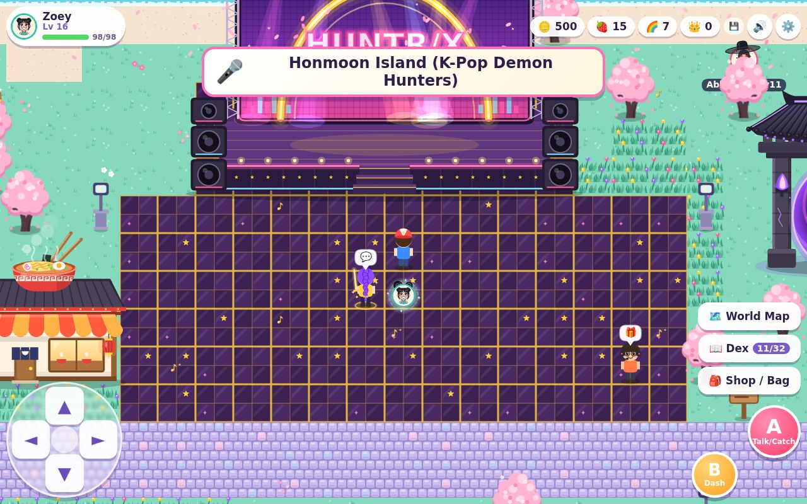
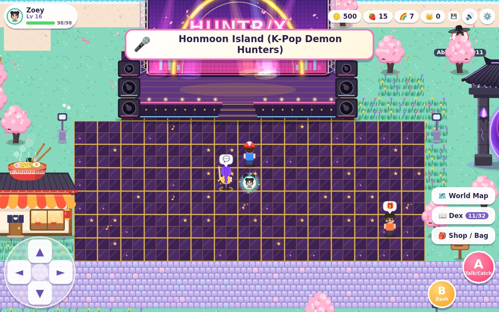
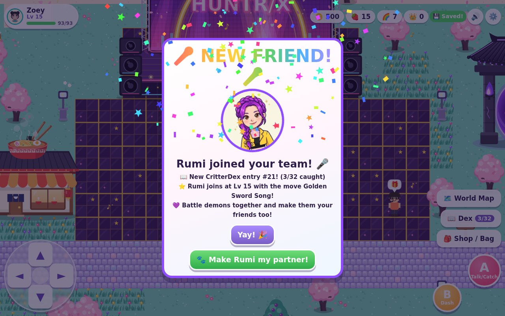
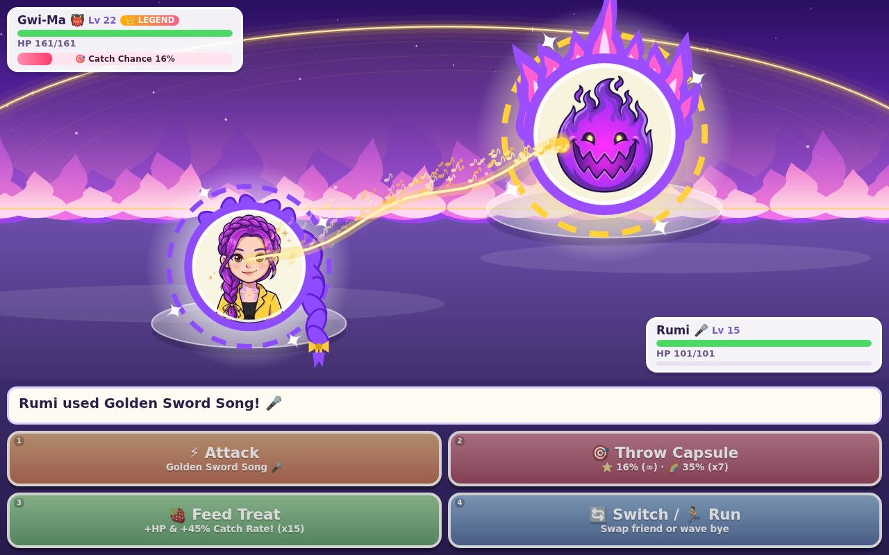
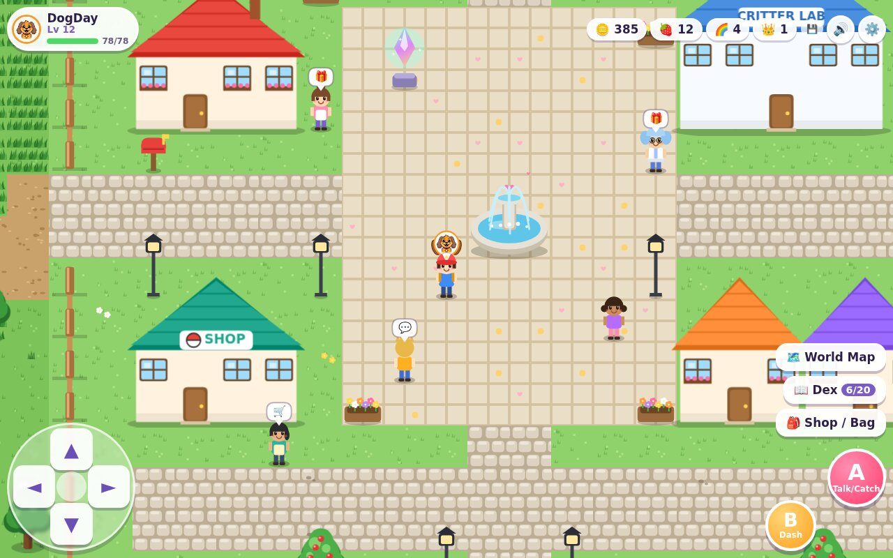
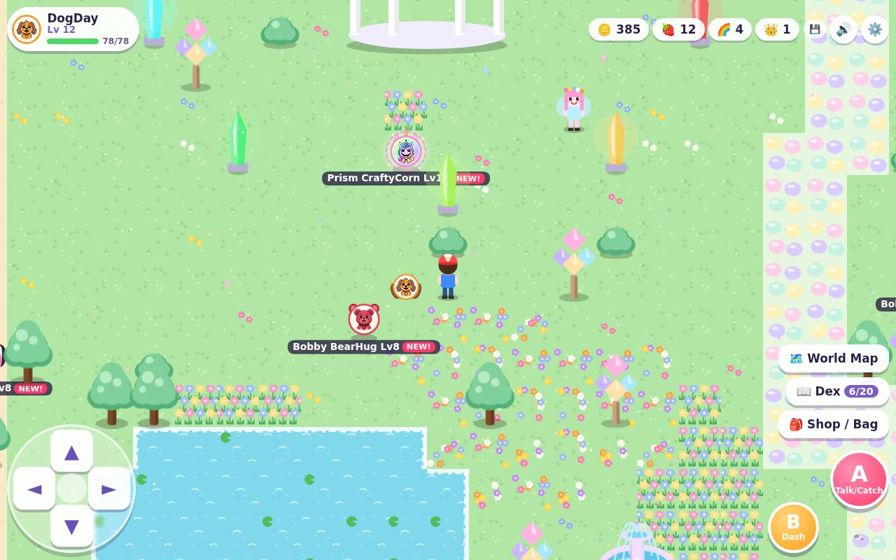
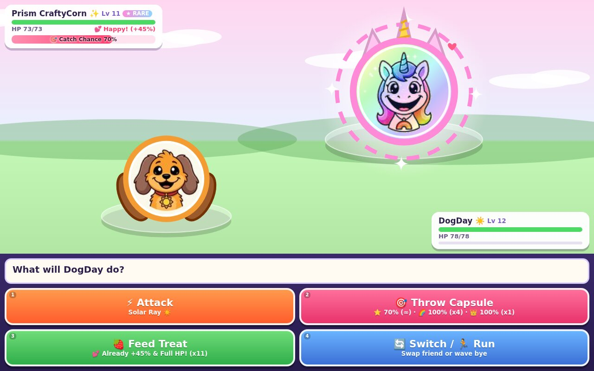
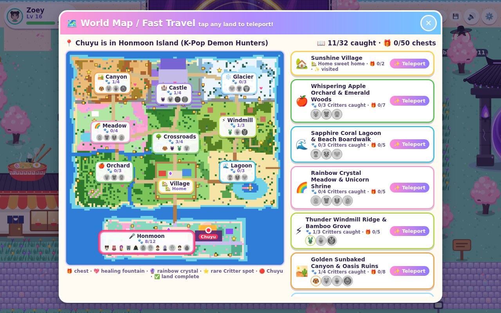
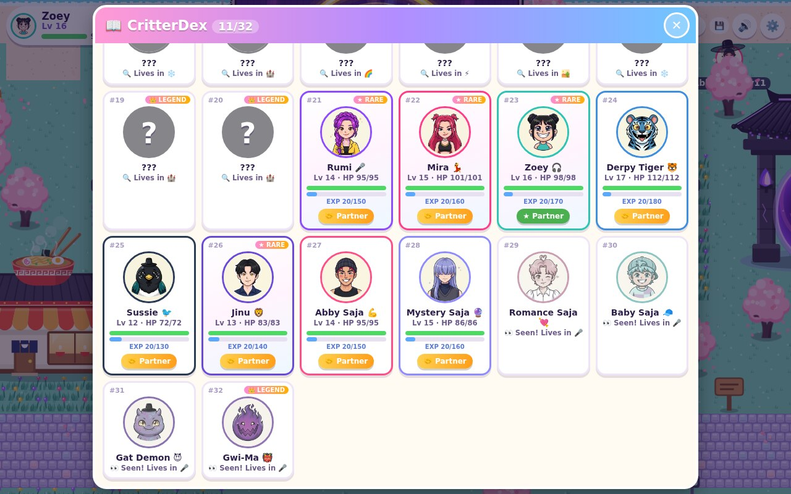

# 🌈🐾 Chuyu's Critter Quest: Rainbow Island RPG

🎮 **Play Live (GitHub Pages):** **[https://kunruiw1991.github.io/critters-quest-rpg/](https://kunruiw1991.github.io/critters-quest-rpg/)**

A cozy, kid-friendly **2D classic RPG** — a simple Pokémon-style adventure where **Chuyu** explores a huge
**120 × 90 tile Rainbow Island** with **8 hand-themed biomes** and — 🆕 **NEW!** — **Honmoon Island**, home of the
**K-Pop Demon Hunters** 🎤, makes friends with villagers, opens treasure chests, shakes fruit trees, and
**catches all 32 Critters** for the CritterDex!



## 🆕 NEW: Honmoon Island — the K-Pop Demon Hunters expansion 🎤✨

| 🎤 Golden Honmoon Stage | 💜 Rumi joins the team! | 👹 Boss battle: Gwi-Ma |
|---|---|---|
|  |  |  |

- **🌉 Golden Honmoon Bridge**: walk out of Sunshine Village's south gate (or tap **Honmoon** on the 🗺️ World Map) to cross the sea
  to a brand-new 9th land: a twilight K-pop city island with cherry blossoms 🌸, glowing lanterns, golden music notes ♪ and
  falling petals.
- **Landmarks**: the **Golden Honmoon Stage** (spotlights + golden Honmoon arch), **N Seoul Tower** on Namsan Hill,
  **Zoey's favorite Ramen Shop** 🍜 (tap it and every Critter slurps up ramen and gets full energy!), the **Golden Honmoon Fountain**,
  **Celine's Hanok**, and the swirling purple **Demon Gate** 👹.
- **HUNTR/X join your team!** Say hi to **Rumi** 🎤 (at the stage), **Mira** 💃 (by N Seoul Tower) and **Zoey** 🎧 (at the ramen
  shop). After a short chat each hero **joins Chuyu's team at Lv 15** — no capsule needed — with a 🎤 *NEW FRIEND!* celebration and a
  1-tap *"Make her my partner!"* button, so Rumi can follow Chuyu around the whole world.
- **Friends**: **Celine** (the HUNTR/X mentor, gives 3 🌈 Rainbow Capsules) and **Bobby** (their manager, gives a VIP backstage
  bonus of 🪙 120 + 3 🍓).
- **12 new Critters (#21–#32)** with brand-new illustrated portraits:

  | # | Critter | Rarity | Where | Move |
  |---|---------|--------|-------|------|
  | 21 | 🎤 **Rumi** | ★ Hero | Joins at the Golden Honmoon Stage | Golden Sword Song |
  | 22 | 💃 **Mira** | ★ Hero | Joins by N Seoul Tower | Gokdo Twirl |
  | 23 | 🎧 **Zoey** | ★ Hero | Joins at the Ramen Shop | Shinkal Star Toss |
  | 24 | 🐯 **Derpy Tiger** | Common | Roams Honmoon Island | Derpy Pounce |
  | 25 | 🐦 **Sussie** (magpie in a gat hat) | Common | Roams Honmoon Island | Magpie Swoop |
  | 26 | 🦁 **Jinu** | ★ Rare | Always waits at the N Seoul Tower lookout | Soda Pop Serenade |
  | 27 | 💪 **Abby Saja** | Uncommon | Roams Honmoon Island | Muscle Pop Pose |
  | 28 | 🔮 **Mystery Saja** | Uncommon | Roams Honmoon Island | Hidden Hush Wave |
  | 29 | 💘 **Romance Saja** | Uncommon | Roams Honmoon Island | Heart Wink |
  | 30 | 🧢 **Baby Saja** | Uncommon | Roams Honmoon Island | Bubble Pop Beat |
  | 31 | 😈 **Gat Demon** | Common | Roams Honmoon Island | Sneaky Swirl |
  | 32 | 👹 **Gwi-Ma** (the demon king) | 👑 Legendary | Always waits at the Demon Gate (Lv 22) | Violet Flame Chomp |

- **Kid-friendly demons**: the Saja Boys, the Gat Demon and even Gwi-Ma are silly, never scary — battling them just makes them
  dizzy, and catching them makes them friends. Gwi-Ma gets his own **boss battle**: a violet-flame sky held back by a golden
  Honmoon arc and an exciting (but not spooky) boss theme.
- **4 new elemental types**: 🎤 *Golden* and 🎶 *Pop* fire a glowing **ribbon of music notes**, 👹 *Demon* throws **violet flames**,
  🐯 *Spirit* sparkles with folk-art stars.
- **New music**: an original bouncy K-pop-style chiptune for Honmoon Island and a Gwi-Ma boss theme.
- **Old saves keep everything**: Rainbow Island's layout is byte-for-byte identical (all 44 original chests, trees and paths stay
  put), and Professor Bubba gives returning players a one-time *"Big news!"* message pointing to the new bridge.

| 🏡 Sunshine Village | 🌈 Crystal Meadow | ⚔️ Catching a rare Prism CraftyCorn |
|---|---|---|
|  |  |  |
| **🗺️ World Map / Fast Travel** | **📖 CritterDex** | |
|  |  | |

---

## ✨ Highlights

- **Huge 120 × 118 world (14,160 tiles, 48 px tiles)**: the original 120 × 90 Rainbow Island plus Honmoon Island in the southern sea,
  generated deterministically, so every player gets the same islands. Every chest, tree, NPC, fountain, crystal and rare spot is
  checked to be reachable on foot (`World.audit().unreachable` is always `[]`). No softlocks.
- **9 lands + a central park**, each with its own tile palette, landmarks, music, weather particles and Critters:

  | # | Region | Landmarks | Critters |
  |---|--------|-----------|----------|
  | 1 | 🏡 **Sunshine Village** | Chuyu's red-roof house, Professor Bubba's Critter Lab, Capsule & Berry Shop, Healing Fountain, flowerbeds, lamps, cobblestone streets, the south gate to the Golden Honmoon Bridge | *(safe town, no wild Critters)* |
  | 2 | 🍎 **Whispering Apple Orchard & Emerald Woods** | Apple-tree rows, streams with wooden bridges, a secret glade with a fairy mushroom ring | PickyPiggy 🍎, Bobby BearHug ❤️, Mikey 🌿 |
  | 3 | 🌊 **Sapphire Coral Lagoon & Beach Boardwalk** | Golden beach, palms, seashells, boardwalk, lighthouse pier, coral stepping stones, lagoon island | JJ 🌊, Poppy Dash 🌸, Bubba Bubbaphant 💡 |
  | 4 | 🌈 **Rainbow Crystal Meadow & Unicorn Shrine** | Pastel flower fields, glowing crystal pillars, fairy pond, Unicorn Gazebo | CraftyCorn 🌈, Bobby ❤️, Poppy 🌸, ✨ **Prism CraftyCorn** |
  | 5 | ⚡ **Thunder Windmill Ridge & Bamboo Grove** | Spinning windmills, bamboo trail, bouncy trampoline pads, Lightning Shrine | Hoppy Hopscotch ⚡, KickinChicken ⭐, ⚡ **Thunderbolt Hoppy** |
  | 6 | 🏜️ **Golden Sunbaked Canyon & Oasis Ruins** | Great Pyramid, little pyramid, palm oasis, cactus trails, ruins, buried treasure | DogDay ☀️, SunnyFox 🦊, KickinChicken ⭐, 🌟 **Superstar KickinChicken** |
  | 7 | ❄️ **Frostberry Glacier & Aurora Hot Springs** | Snowy pines, frozen lake, aurora ice crystals, steaming hot springs, snowmen | Bubba 💡, Huggy Wuggy 🧸, ❄️ **Aurora Huggy** |
  | 8 | 🏰 **Starlight Lavender Sanctuary & Moon Castle** | Lavender rows, moon lanterns, Starlight Moon Castle courtyard, Sun & Moon Altars | CatNap 🌙, LunaBat 🦇, 🌌 **Galaxy CatNap**, 👑 **Solar Crown DogDay** |
  | 9 🆕 | 🎤 **Honmoon Island (K-Pop Demon Hunters)** | Golden Honmoon Bridge, Golden Honmoon Stage, N Seoul Tower, Ramen Shop, Golden Honmoon Fountain, Celine's Hanok, Demon Gate, cherry blossoms | Rumi, Mira, Zoey (join!), Derpy Tiger 🐯, Sussie 🐦, Gat Demon 😈, Saja Boys 🎶, ★ **Jinu**, 👑 **Gwi-Ma** |
  | ★ | 🌳 **Rainbow Crossroads Park** (bonus hub) | Rainbow Lake with a treasure island, signposts to every land | DogDay, CatNap, Hoppy, PickyPiggy |

- **32 Critters**: 20 Rainbow Island Critters (14 core + 6 sparkling rare/legendary variants) and 12 Honmoon friends. Rares use
  glowing aura rings and ★ / 👑 badges. Each rare **always waits at its landmark until caught**, so 32/32 is always reachable.
- **80 visible overworld Critters** hop around every land with animated ears, tails, wings, gat hats, braids and flames, name tags,
  in-pill `NEW!` / `★` / `👑` badges and speech bubbles (`🍎!`, `☀️`, `Rawr~`, `🎶`). Every species in a land is always roaming
  somewhere, and at least two Critters are on screen right after each teleport. Rustling through **tall grass / flower patches**
  can trigger surprise encounters too. Tap a Critter and it waits (`❗`) while Chuyu walks over.
- **50 treasure chests 🎁, 26 shakeable fruit trees 🌳 (they regrow!), 10 healing spots 💖 (fountains, hot springs and a ramen shop)
  and 9 Rainbow Waypoint Crystals 🔮**, plus 24 friendly villagers and heroes with tips, gifts and team-ups.
- **Automatic 🦆 Duckie Float** when Chuyu wades into shallow water (his partner gets a little swim ring too!), pink **coral
  stepping stones** across the deep lagoon, and **trampoline pads** that bounce him 3 tiles across Windmill Ridge (tap one to boing!).

## ⚔️ Kid-friendly battles & catching

Four big buttons. Use touch, mouse, keys `1` `2` `3` `4`, or arrow keys + `Enter`/`Space`:

1. **⚡ Attack**: an elemental skill with a projectile effect (Solar Ray, Moon Starbeam, Thunder Hop, Rainbow Swirl, Heart Wave,
   Golden Sword Song…).
   **Mercy Catch Rule:** attacks *never* drop a wild Critter below **1 HP**. It just gets **"Dizzy & Ready to Catch! 🎯"**.
   Tapping Attack on a Dizzy Critter jumps straight to the capsule menu, so no turn is wasted.
   A battle only ends without a catch if Chuyu explicitly picks **🏁 Finish Battle**. Landmark rares stay at their spot until caught.
2. **🎯 Throw Capsule**: **⭐ Star Capsule (∞ free)**, **🌈 Rainbow Capsule (×2.2)**, **👑 Master Star Capsule (100%)**.
   Live odds are shown on every button. Animated arc, 3 suspenseful wiggles, then a **✨ GOTCHA!** celebration with confetti,
   party EXP, gold, a CritterDex entry and a 1-tap **"🐾 Make it my partner!"** button.
3. **🍓 Feed Treat**: heals Chuyu's Critter **and** makes the wild Critter happy (**+45% catch chance**). No berry is wasted
   when it wouldn't help.
4. **🔄 Switch / 🏃 Run**: swap partners from the whole collection, or wave a friendly goodbye.

Out of capsules or berries far from town? **🛒 Penny's Express** quick-buys one right inside the battle if Chuyu has the gold.

**Catch chance** (always shown live as a 🎯 meter):

```
chance = min(1, baseRate × hpBonus × capsule + (fed ? 0.45 : 0))
baseRate: common .45 · uncommon .36 · rare .25 · legendary .16
hpBonus  = 1 + (1 − (hp − 1)/(maxHp − 1))     → 1.0 at full HP, 2.0 when Dizzy
capsule  = Star ×1.0 · Rainbow ×2.2 · Master = 100%
```

If every Critter on the team gets sleepy, Chuyu just hurries back to the last Healing Fountain. Nobody faints and nothing is lost.

## 🎮 Controls

| Action | Touch / Mouse | Keyboard |
|--------|---------------|----------|
| Walk | **Tap anywhere** (auto-pathfinding around obstacles, with a destination ring) or the **▲▼◄►** D-pad | Arrow keys / WASD |
| Talk / Open / Catch | Tap the chest / tree / NPC / Critter (auto-walks there and uses it) or **A** | Enter / Space / Z |
| ⚡ Roller-skate dash | **B** (toggle) | B or X (toggle), hold Shift |
| 🗺️ World Map / Fast Travel | **World Map** button | M |
| 📖 CritterDex (X/32) | **Dex** button | C |
| 🎒 Shop / Bag | **Shop / Bag** button | I or E |
| Menu (sound, save, help, 🔄 New Adventure) | ⚙️ | Esc |

- **🗺️ Interactive World Map**: both islands with land labels, Chuyu's live position, unopened chests, fountains,
  crystals, rare-spot stars, habitat portraits with *caught/total* per land, a glowing **🆕 NEW** badge on Honmoon Island until
  Chuyu visits it, and **1-tap teleport** to any land.
- **📖 CritterDex**: all 32 entries (unknown → seen → caught), levels, HP/EXP bars, habitats, and **1-tap "🤝 Partner"**.
  Your partner follows Chuyu around the overworld, like Pikachu in Pokémon Yellow!
- **🛒 Shop** (from the Shop / Bag button anywhere, or from Penny in the village): 🍓 Berries (1 = 10 🪙, 5 = 40, 10 = 75),
  🌈 Rainbow Capsules (1 = 30, 3 = 75) and 👑 Master Star Capsules (250). Star Capsules are always free. A live tip shows how
  many unopened chests, villager gifts and ripe fruit trees are left on the islands.
- **⭐ Level-ups** happen in battle and on the overworld (star burst over the follower). The Dex shows HP/EXP bars for every
  caught Critter and a 🏆 trophy banner at 32/32.
- **🔊 WebAudio chiptunes**: a melody for each land, an upbeat battle theme, a Gwi-Ma boss theme, encounter fanfare, attack whooshes,
  capsule wiggle beeps and a victory jingle. Mute toggle 🔊/🔇 is remembered.
- **💾 Auto-save** (`localStorage`) after every catch, team-up, chest, gift, purchase, level-up and teleport, plus every 20 s and when
  the tab is hidden. A `💾 Saved!` indicator flashes each time, and the ⚙️ Menu shows "Last saved". Chuyu's exact tile, his
  follower's tile, the team, opened chests, inventory and play time all come back after a reload.
  **🔄 New Adventure** (⚙️ Menu) starts over cleanly.

## 🧱 Project structure

```
index.html          HUD, battle, modals, title & celebration overlays
css/style.css       Responsive layout (desktop 1280×800, iPad, phone portrait 390×844 & landscape 844×390)
js/data.js          Critters, regions, items, villagers & heroes, formulas
js/util.js          Seeded RNG, value noise, easing, binary heap
js/world.js         Deterministic Rainbow Island + Honmoon Island generator, connectivity audit/repair
js/art.js           Procedural tile atlas, landmarks, characters, critter medallions, rare-variant recoloring, minimap, battle skies
js/audio.js         WebAudio chiptune sequencer + sound effects
js/battle.js        Battle system (mercy rule, capsules, feeding, switching, music-note & flame attacks)
js/ui.js            HUD, dialogue, World Map, CritterDex, Shop/Bag, menu, title, GOTCHA / NEW FRIEND overlay
js/game.js          Main loop, camera, controls, tap-to-walk BFS pathfinding, overworld Critters, hero team-ups, saving
icons/*.jpg         14 official Critter portraits + 12 illustrated Honmoon Island portraits
```

No build step and no dependencies. Open `index.html` through any static web server.

### 🧪 Developer test hooks

`window.CritterQuest` exposes `state`, `mode`, `player`, `follower`, `wilds`, `teleportToRegion(z)`, `teleportTo(x, y)`,
`walkTo(x, y)`, `tapWorld(wx, wy)`, `screenOf(tx, ty)`, `beginBattle(speciesId, level)`, `setPartner(id)` and `save()`.
`World.audit()` reports map size, object counts and unreachable targets (always `[]`). `Battle.act('attack'|'catch'|'feed'|'switch')`,
`Battle.subAct('throw', 'star'|'rainbow'|'master')`, `Battle.chance(capsule)` and `Art.stats()` (atlas memory) help with scripted tests.

### ✅ Quality

Built with a 10-round creator/critic audit covering world connectivity, spawns, battle math, controls, map, CritterDex,
economy, responsive layouts, save/audio and live headless gameplay. Every round ended with no open issues.
Verified in headless Chrome at 1280×800, 1024×768, 820×1180, 390×844, 844×390, 667×375 and 360×640: 0 console warnings or
errors, 0 off-screen controls, about 60 FPS.

**Honmoon Island expansion checks**: a generator diff against the previous version shows Rainbow Island is unchanged except the
bridge tiles (same 44 chests with the same loot, same villagers, same decals), `World.audit()` reports 0 repairs and 0 unreachable
targets for both islands, old saves load with their chests, position and team intact, and the hero team-up, ramen healing,
Gwi-Ma boss battle, World Map and CritterDex flows were played end-to-end in headless Chrome with 0 console errors.

---

Made with 💖 for Chuyu.
