# 🌈🐾 Chuyu's Critter Quest: Rainbow Island RPG

🎮 **Play Live (GitHub Pages):** **[https://kunruiw1991.github.io/critters-quest-rpg/](https://kunruiw1991.github.io/critters-quest-rpg/)**

A cozy, kid-friendly **2D classic RPG** — a Pokémon-style adventure where **Chuyu** explores a huge
**120 × 230 tile world (27,600 tiles)** across **15 hand-themed lands + Rainbow Crossroads Park (`Zones 1..16`)** and **20 enterable embedded small maps** (cozy village halls, mushroom grottos, crystal caverns, sea-bottom coral cities, pirate shipwrecks, pharaoh tombs, glacier caves, moon dungeons, secret treehouses, K-Pop backstage lounges, underworld sanctums, Minhwa tiger dens, bathhouse steam grottos, funhouse mazes, and legendary Pokémon sanctums),
makes friends with villagers, heroes & Champions, rights knocked-over flowerpots, opens treasure chests, shakes fruit trees, battles 20 sub-map Bosses/Guardians, and
**catches all 80 Critters** for the CritterDex!

## 🚪🏰 NEW: 20 Enterable Embedded Small Maps Across All 16 Regions!

| 🏡 Sunshine Cozy Village Hall (`submap_01`) | 🐚 Sea-Bottom Coral City (`submap_04`) | 🎤 Honmoon Backstage Idol Lounge (`submap_10`) | 🔥 Gwi-Ma's Underworld Sanctum (`submap_11`) |
|---|---|---|---|
| 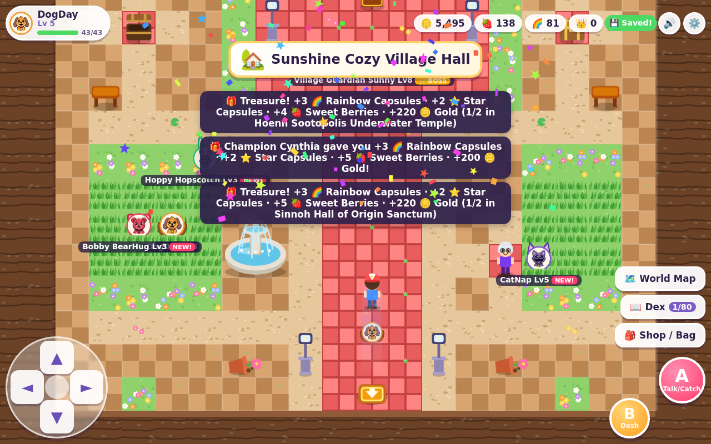 | 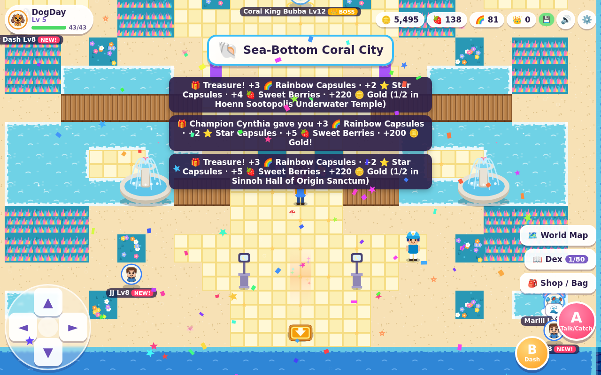 | 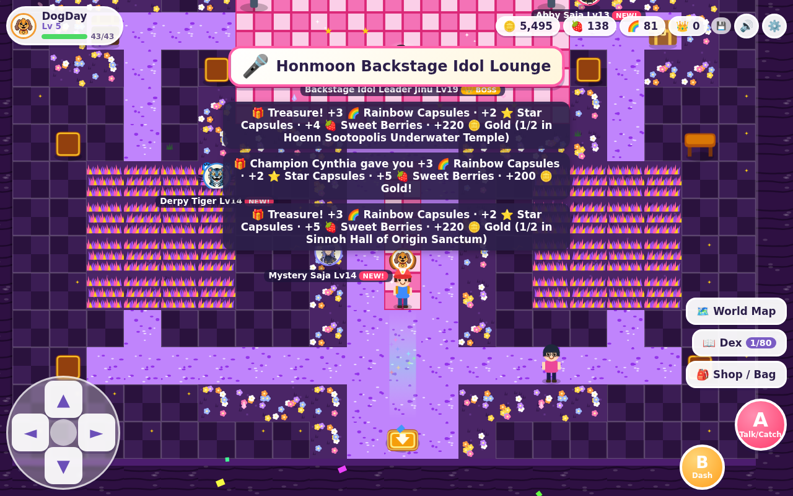 | 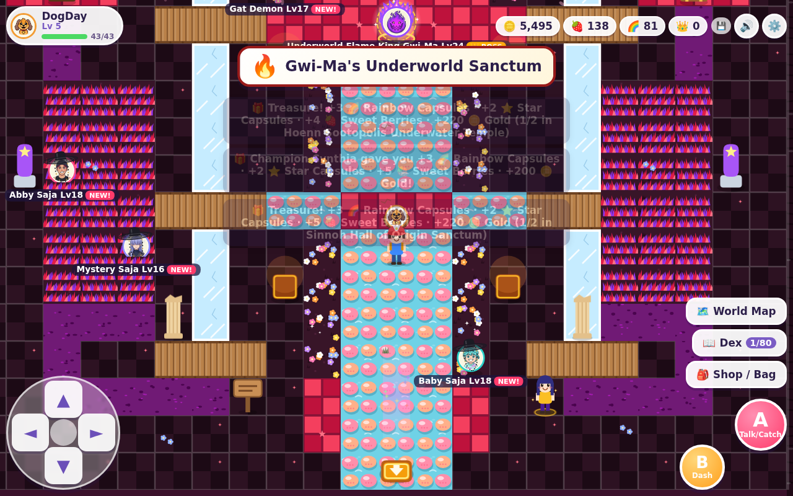 |
| **🧬 Kanto Cerulean Cave (`submap_15`)** | **✨ Sinnoh Hall of Origin Sanctum (`submap_20`)** | **⚔️ Standing Boss / Guardian Battle (Arceus)** | **🗺️ World Map with All 20 Sub-Map Pins** |
| 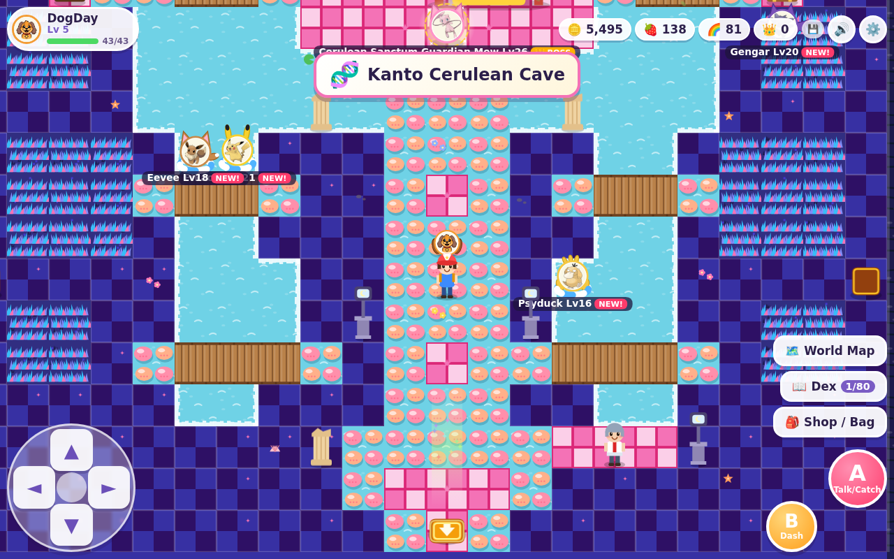 | 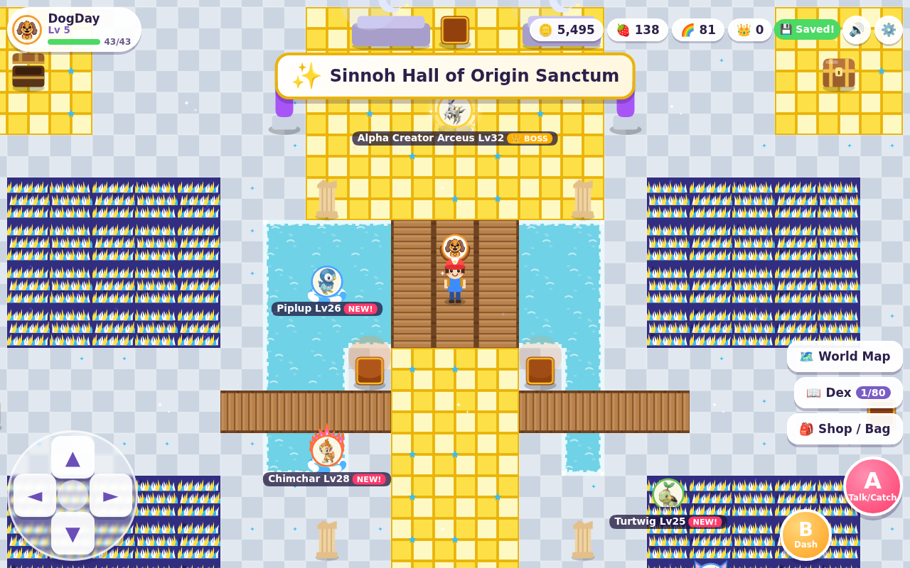 | 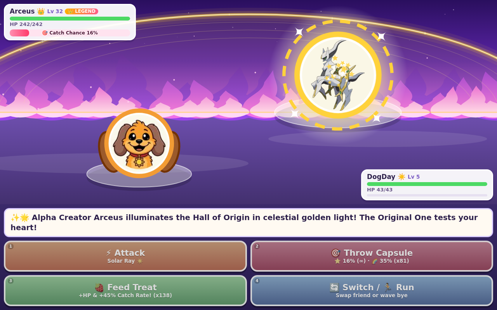 | 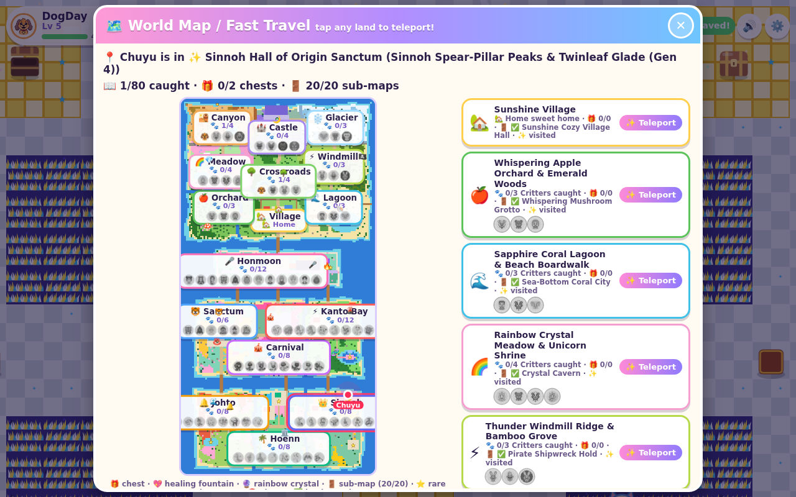 |

Every region across the `120 × 230` overworld now features interactive **Sub-Map Entrances** (`🚪` doors, glowing caves, whirlpools, hatches, pyramid tombs, ladders, neon doors, underworld rifts, bathhouse curtains, and temple stairs). Walk onto an entrance, tap it, or press `A` (`Enter` / `Space` / `Z`) to step inside—and step onto the interior exit mat to return to the exact overworld entrance tile!

- **20 Self-Contained Interior Maps (`20 × 16` to `26 × 20` tiles)** with custom color palettes (`Art.PAL[21..40]`), procedural furniture & interactive props, **40 interior treasure chests**, **20 friendly Host NPCs** who bestow a one-time gift, roaming thematic wild Critters, and **20 standing Boss / Guardian encounters** with custom battle intros and victory blessings!
- **100% Reachability & Save Persistence**: Verified programmatically via `World.audit()` (`repairs === 0`, `unreachable.length === 0`) and `World.auditSubmaps()` (`count === 20`, `ok === true`, `unreachable.length === 0`), with full mid-dungeon save/reload persistence in `critterQuestRPG_v1`.

| # | Sub-Map ID | Name & Emoji | Zone | Overworld Entrance `(x, y)` | Size `W × H` | Host NPC & Gift | Wild Critters | Standing Boss / Guardian |
| :-: | :--- | :--- | :-: | :-: | :-: | :--- | :--- | :--- |
| 1 | `submap_01` | 🏡 **Sunshine Cozy Village Hall** | Zone 1 | `(60, 67)` | `20 × 16` | **Elder Sunny** (`3 🍓, 2 ⭐, 50 🪙`) | DogDay, CatNap, Hoppy, Bobby | **Village Guardian Sunny** (`sunny`, Lv 8) |
| 2 | `submap_02` | 🍄 **Whispering Mushroom Grotto** | Zone 2 | `(16, 78)` | `22 × 16` | **Herbalist Fern** (`4 🍓, 1 🌈, 60 🪙`) | PickyPiggy, Bobby, Mikey, Poppy | **Grotto Guardian Mikey** (`mikey`, Lv 10) |
| 3 | `submap_03` | 💎 **Crystal Cavern** | Zone 4 | `(17, 37)` | `22 × 18` | **Crystal Sage Lyra** (`2 🌈, 2 ⭐, 80 🪙`) | CraftyCorn, Bobby, Poppy, Prism | **Prism Guardian CraftyCorn** (`prism`, Lv 13) |
| 4 | `submap_04` | 🐚 **Sea-Bottom Coral City** | Zone 3 | `(98, 67)` | `24 × 18` | **Coral Diver Marina** (`2 🌈, 3 🍓, 75 🪙`) | JJ, Poppy, Bubba, Marill | **Coral King Bubba** (`bubba`, Lv 12) |
| 5 | `submap_05` | 🏴‍☠️ **Pirate Shipwreck Hold** | Zone 5 | `(112, 35)` | `24 × 16` | **First Mate Barnaby** (`2 🌈, 2 ⭐, 110 🪙`) | Hoppy, KickinChicken, JJ, Thunderbolt | **Storm-Captain Thunderbolt** (`thunderbolt`, Lv 14) |
| 6 | `submap_06` | 🏺 **Pyramid Pharaoh Tomb** | Zone 6 | `(15, 11)` | `24 × 18` | **Explorer Nile** (`2 🌈, 3 ⭐, 130 🪙`) | DogDay, SunnyFox, KickinChicken, Superstar | **Pharaoh Guardian Superstar** (`superstar`, Lv 16) |
| 7 | `submap_07` | ❄️ **Glacier Ice Cavern** | Zone 7 | `(84, 13)` | `22 × 18` | **Skier Yukiko** (`2 🌈, 4 🍓, 120 🪙`) | Bubba, Huggy Wuggy, Aurora | **Aurora Guardian Fluff** (`aurora`, Lv 18) |
| 8 | `submap_08` | 🌙 **Starlight Moon Dungeon** | Zone 8 | `(59, 12)` | `24 × 18` | **Astrologer Selene** (`3 🌈, 3 ⭐, 150 🪙`) | CatNap, LunaBat, Galaxy, Solar | **Moon-Sanctum Guardian Galaxy** (`galaxy`, Lv 21) |
| 9 | `submap_09` | 🌳 **Crossroads Secret Treehouse** | Zone 9 | `(63, 45)` | `20 × 16` | **Scout Maple** (`2 🌈, 4 🍓, 100 🪙`) | DogDay, CatNap, Hoppy, Solar | **Canopy Guardian Solar** (`solar`, Lv 15) |
| 10 | `submap_10` | 🎤 **Honmoon Backstage Idol Lounge** | Zone 10 | `(81, 101)` | `22 × 16` | **Manager Bobby** (`3 🌈, 4 🍓, 150 🪙`) | Derpy, Sussie, Abby, Mystery, Romance, Jinu | **Backstage Idol Leader Jinu** (`jinu`, Lv 19) |
| 11 | `submap_11` | 🔥 **Gwi-Ma's Underworld Sanctum** | Zone 10 | `(90, 102)` | `24 × 18` | **Guardian Mentor Celine** (`1 👑, 3 🌈, 180 🪙`) | Gat Demon, Baby, Abby, Mystery, Jinu, Gwi-Ma | **Underworld Flame King Gwi-Ma** (`gwima`, Lv 24) |
| 12 | `submap_12` | 🐯 **Derpy's Secret Tiger Den** | Zone 11 | `(23, 130)` | `22 × 16` | **Minhwa Painter Seojun** (`3 🌈, 4 🍓, 140 🪙`) | Derpy, Sussie, Flight Dokkaebi, Jeoseung, Gat-Derpy | **Secret Den Guardian Gat-Derpy** (`gatderpy`, Lv 20) |
| 13 | `submap_13` | ♨️ **Bathhouse Steam Grotto** | Zone 11 | `(22, 148)` | `20 × 16` | **Bathhouse Auntie Bora** (`5 🍓, 2 🌈, 130 🪙`) | Water Demon, Derpy, Sussie, Jeoseung | **Steam-Spring Lord Water Demon** (`waterdemon`, Lv 19) |
| 14 | `submap_14` | 🎪 **Nightmare Funhouse Maze** | Zone 12 | `(55, 133)` | `24 × 18` | **Ringmaster Trick** (`3 🌈, 3 ⭐, 160 🪙`) | Baba, Icky, Rabie, Allister, Poe, Touille, Maggie | **Mirror-Maze Ringmaster Simon Smoke** (`simon`, Lv 22) |
| 15 | `submap_15` | 🧬 **Kanto Cerulean Cave** | Zone 13 | `(95, 155)` | `24 × 18` | **Professor Oak's Aide** (`1 👑, 3 🌈, 200 🪙`) | Pikachu, Eevee, Psyduck, Gengar, Snorlax, Mew | **Cerulean Sanctum Guardian Mew** (`mew`, Lv 26) |
| 16 | `submap_16` | 🌋 **Volcano Magma Chamber** | Zone 13 | `(104, 129)` | `22 × 18` | **Volcano Tamer Blaine** (`3 🌈, 3 ⭐, 180 🪙`) | Charmander, Pikachu, Meowth, Gengar, Charizard | **Magma Core Guardian Charizard** (`charizard`, Lv 24) |
| 17 | `submap_17` | 🌊 **Johto Whirl Islands Abyss** | Zone 14 | `(20, 185)` | `24 × 18` | **Tidal Sage Hiro** (`1 👑, 3 🌈, 220 🪙`) | Totodile, Marill, Umbreon, Suicune, Lugia | **Abyssal Roost Guardian Lugia** (`lugia`, Lv 28) |
| 18 | `submap_18` | 🔔 **Bell Tower Sacred Attic** | Zone 14 | `(30, 188)` | `22 × 18` | **Bell Keeper Eusine** (`3 🌈, 4 ⭐, 200 🪙`) | Chikorita, Cyndaquil, Togepi, Umbreon, Suicune | **Sacred Bell Guardian Suicune** (`suicune`, Lv 27) |
| 19 | `submap_19` | 🏛️ **Hoenn Sootopolis Underwater Temple** | Zone 15 | `(64, 204)` | `24 × 18` | **Champion Steven** (`1 👑, 4 🌈, 250 🪙`) | Treecko, Torchic, Mudkip, Gardevoir, Milotic, Absol | **Sky-Temple Guardian Rayquaza** (`rayquaza`, Lv 30) |
| 20 | `submap_20` | ✨ **Sinnoh Hall of Origin Sanctum** | Zone 16 | `(103, 184)` | `26 × 20` | **Champion Cynthia** (`2 👑, 5 🌈, 300 🪙`) | Turtwig, Chimchar, Piplup, Shinx, Buneary, Lucario, Garchomp | **Alpha Creator Arceus** (`arceus`, Lv 32) |

---

## 🌟 The Grand Pokémon Continent Expansion — Generations 2, 3 & 4 (Johto 🔔, Hoenn 🌴 & Sinnoh 👑)

| 🔔 Johto Bell-Tower Groves (Gen 2) | 🌴 Hoenn Sky-Pillar Tropics (Gen 3) | 👑 Sinnoh Spear-Pillar Peaks (Gen 4) |
|---|---|---|
| 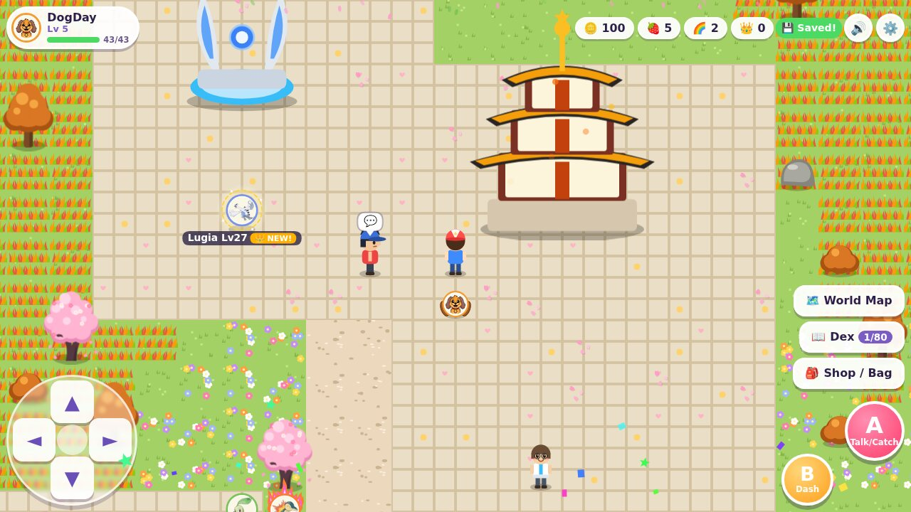 | 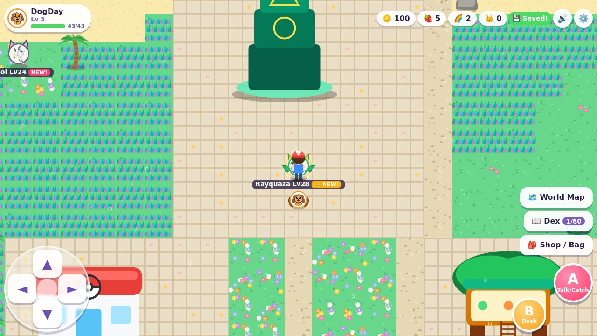 | 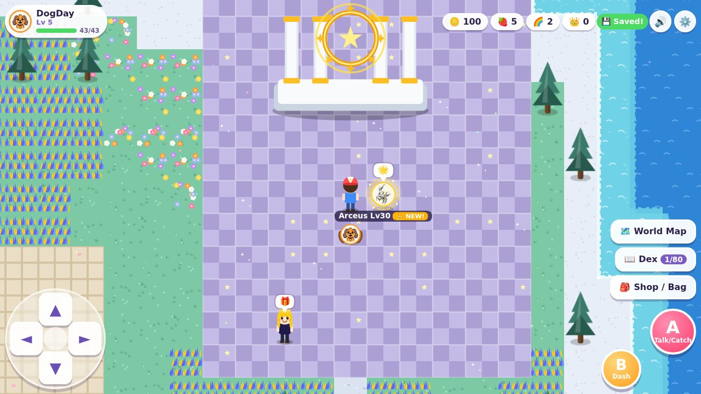 |

Three grand sea bridges lead south from the Southern Continent (`x = 24`, `x = 64`, `x = 90`) into the **Grand Pokémon Continent** (`rows 174..229`), bringing **24 iconic Pokémon from Generations 2, 3 & 4 (`#57–#80`)**:

### 1. 🔔 Johto Bell-Tower Groves & Ecruteak Lake (Zone 14 — Generation 2)
- **Landmarks & Friends**: **Ecruteak Bell Tower** 🔔 (golden-roofed 3-tier pagoda), **Whirl Island Lugia Roost** 🌊, **Johto Pokémon Center** ❤️, **Kurt's Apricorn Workshop** 🌰 (Kurt gifts `4 🌈 + 5 🍓`), **Professor Elm**, and **Ethan**.
- **8 Generation 2 (Johto) Pokémon (`#57–#64`)**:
  - `#57` 🍃 **Chikorita** (*Leaf* — *Magical Leaf*)
  - `#58` 🔥 **Cyndaquil** (*Sun* — *Flame Wheel*)
  - `#59` 🐊 **Totodile** (*Water* — *Aqua Bite*)
  - `#60` 🥚 **Togepi** (*Star* — *Metronome Sparkle*)
  - `#61` 🫧 **Marill** (*Water* — *Aqua Tail Bounce*)
  - `#62` 🌙 **Umbreon** (*Moon* — *Moonlight Pulse*)
  - `#63` 💎 **Suicune** (`★ Rare` *Ice* — *Aurora Beam*, waits at the Ecruteak Crystal Spring)
  - `#64` 🪶 **Lugia** (`👑 Legendary` *Galaxy* — *Aeroblast*, rests at Whirl Island Lugia Roost, Lv 27)

### 2. 🌴 Hoenn Sky-Pillar Tropics & Sootopolis Lagoon (Zone 15 — Generation 3)
- **Landmarks & Friends**: **Sky Pillar Tower** 🐉, **Hoenn Pokémon Center** ❤️, **Hoenn Secret Base Treehouse** 🌴, **Sootopolis Lagoon**, **Steven's Meteor Crater**, **Professor Birch**, **Champion Steven Stone** (gifts `200 🪙 + 3 🌈`), and **May**.
- **8 Generation 3 (Hoenn) Pokémon (`#65–#72`)**:
  - `#65` 🦎 **Treecko** (*Leaf* — *Leaf Blade*)
  - `#66` 🐥 **Torchic** (*Sun* — *Ember Peck*)
  - `#67` 💦 **Mudkip** (*Water* — *Muddy Splash*)
  - `#68` 💖 **Gardevoir** (*Rainbow* — *Dazzling Gleam*)
  - `#69` 🌈 **Milotic** (*Water* — *Hydro Rainbow*)
  - `#70` 🌙 **Absol** (*Moon* — *Night Slash*)
  - `#71` ⚡ **Metagross** (`★ Rare` *Thunder* — *Meteor Mash*, waits at Steven's Meteor Crater)
  - `#72` 🐉 **Rayquaza** (`👑 Legendary` *Galaxy* — *Dragon Ascent*, watches from Sky Pillar Summit, Lv 28)

### 3. 👑 Sinnoh Spear-Pillar Peaks & Twinleaf Glade (Zone 16 — Generation 4)
- **Landmarks & Friends**: **Spear Pillar Temple** 👑 (marble Hall of Origin with a spinning golden celestial wheel), **Sinnoh Pokémon Center** ❤️, **Professor Rowan's Sandgem Lab** 🔬, **Professor Rowan**, **Champion Cynthia** (gifts `3 🌈 + 1 👑 Master Star Capsule`), and **Dawn**.
- **8 Generation 4 (Sinnoh) Pokémon (`#73–#80`)**:
  - `#73` 🌱 **Turtwig** (*Leaf* — *Razor Leaf*)
  - `#74` 🔥 **Chimchar** (*Sun* — *Flame Spin*)
  - `#75` 🐧 **Piplup** (*Water* — *Bubble Peck*)
  - `#76` ⚡ **Shinx** (*Thunder* — *Spark Flash*)
  - `#77` 🎀 **Buneary** (*Pop* — *Dizzy Hop*)
  - `#78` 💠 **Lucario** (`★ Rare` *Spirit* — *Aura Sphere*, trains at the Aura Training Dojo)
  - `#79` 🦈 **Garchomp** (`★ Rare` *Golden* — *Dragon Rush*, waits at Cynthia's Champion Cliff)
  - `#80` 👑 **Arceus** (`👑 Legendary` *Galaxy* — *Judgment Star*, shines at Spear Pillar Temple, Lv 30)

---

## 🐯🎪⚡ The Southern Continent — Derpy's Minhwa Sanctum, Nightmare Critters Carnival & Kanto Classics Bay (Gen 1)

| 🐯 Derpy's Minhwa Sanctum | 🎪 Nightmare Critters Carnival | ⚡ Kanto Classics Bay |
|---|---|---|
| 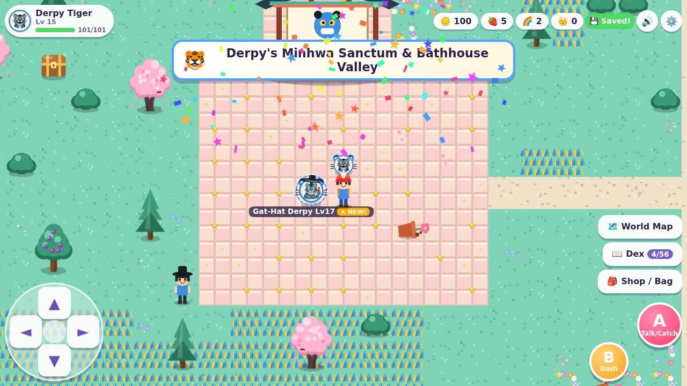 | 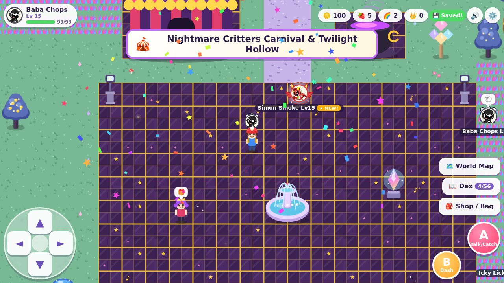 |  |

Three bridges lead south from **Honmoon Island** (`x = 34`, `x = 59`, `x = 90`) into the Southern Continent (`rows 118..173`):

### 1. 🐯 Derpy's Minhwa Sanctum & Bathhouse Valley (Zone 11)
- **🪴 Knocked-Over Flowerpots**: Just like in *KPop Demon Hunters*, Derpy Tiger cannot resist patting tipped-over flowerpots upright! Tap any knocked-over flowerpot (`🪴`) and Derpy Tiger's blue paw pats it upright (`+2 🍓 Sweet Berries · +25 🪙 Gold`).
- **Landmarks & Friends**: **Derpy's Tiger Pavilion**, **Jjimjilbang Bathhouse Springs** ♨️, **Healer Han's Tonic Clinic** (Healer Han gifts `5 🍓 + 2 🌈`), **Minhwa Painter Ji-ho**, and the **Soda Pop Idol Truck** 🥤.
- **4 More Demon Hunter Critters (`#33–#36`)**: `#33` 🎩 **Gat-Hat Derpy** (`★ Rare`), `#34` 💧 **Water Demon**, `#35` ✈️ **Flight Dokkaebi**, `#36` 🏮 **Jeoseung Saja**.

### 2. 🎪 Nightmare Critters Carnival & Twilight Hollow (Zone 12)
- **Landmarks & Friends**: **Nightmare Critters Carnival Tent** 🎪, **Dragon Smoke Cauldron** 🔥, **Sweet-Tooth Carnival Fountain** 💖, **Allister Gator's Swamp Pond**, bouncy trampoline pads, and **Ringleader Harper**.
- **All 8 Official Nightmare Critters (`#37–#44`)**: `#37` 🐑 **Baba Chops**, `#38` 🐸 **Icky Licky**, `#39` 🦇 **Rabie Baby**, `#40` 🐊 **Allister Gator**, `#41` 🐉 **Simon Smoke** (`★ Rare`), `#42` 🐦‍⬛ **Poe**, `#43` 🐀 **Touille**, `#44` 🦈 **Maggie Mako**.

### 3. ⚡ Kanto Classics Bay & Pallet Meadow (Zone 13 — Generation 1)
- **Landmarks & Friends**: **Pokémon Center** ❤️, **Professor Oak's Pallet Lab** (Professor Oak gifts `3 🌈 + 1 👑 Master Star Capsule`), **Ash**, **Misty**, **Brock**, **Snorlax Footbridge**, **Ember Volcano Peak**, and **Cerulean Mew Shrine**.
- **12 Iconic Original First-Generation Pokémon (`#45–#56`)**: `#45` ⚡ **Pikachu**, `#46` 🌱 **Bulbasaur**, `#47` 🔥 **Charmander**, `#48` 💦 **Squirtle**, `#49` 🎤 **Jigglypuff**, `#50` 🌟 **Eevee**, `#51` 🦆 **Psyduck**, `#52` 🪙 **Meowth**, `#53` 👻 **Gengar**, `#54` 😴 **Snorlax** (`★ Rare`), `#55` 🐉 **Charizard** (`★ Rare`), `#56` ✨ **Mew** (`👑 Legendary`).

---

## 🎤 Honmoon Island — the K-Pop Demon Hunters Expansion

| 🎤 Golden Honmoon Stage | 💜 Rumi joins the team! | 👹 Boss battle: Gwi-Ma |
|---|---|---|
|  |  |  |

- **🌉 Golden Honmoon Bridge**: walk out of Sunshine Village's south gate (or tap **Honmoon** on the 🗺️ World Map) to cross the sea
  to Honmoon Island: a twilight K-pop city island with cherry blossoms 🌸, glowing lanterns, golden music notes ♪ and falling petals.
- **Landmarks**: the **Golden Honmoon Stage**, **N Seoul Tower** on Namsan Hill, **Zoey's favorite Ramen Shop** 🍜, the **Golden Honmoon Fountain**, **Celine's Hanok**, and the swirling purple **Demon Gate** 👹.
- **HUNTR/X join your team!** Say hi to **Rumi** 🎤 (at the stage), **Mira** 💃 (by N Seoul Tower) and **Zoey** 🎧 (at the ramen shop) — each hero **joins Chuyu's team at Lv 15**!
- **12 Honmoon Critters (`#21–#32`)**: **Rumi**, **Mira**, **Zoey**, **Derpy Tiger** 🐯, **Sussie** 🐦, **Jinu** 🦁 (`★ Rare`), **Abby Saja** 💪, **Mystery Saja** 🔮, **Romance Saja** 💘, **Baby Saja** 🧢, **Gat Demon** 😈, and **Gwi-Ma** 👹 (`👑 Legendary`).

| 🏡 Sunshine Village | 🌈 Crystal Meadow | ⚔️ Catching a rare Prism CraftyCorn |
|---|---|---|
|  |  |  |
| **🗺️ World Map / Fast Travel (15 Lands)** | **📖 CritterDex (80 Critters)** | |
|  |  | |

---

## ✨ Highlights

- **Huge 120 × 230 world (27,600 tiles, 48 px tiles)**: Rainbow Island (`rows 0..89`), Honmoon Island (`rows 90..117`), the Southern Continent (`rows 118..173`), and the Grand Pokémon Continent (`rows 174..229`), generated deterministically. Every chest, flowerpot, tree, NPC, fountain, crystal and rare spot is verified reachable on foot (`World.audit().unreachable` is always `[]` and `repairs === 0`).
- **15 main lands + Rainbow Crossroads Park**, each with its own tile palette, landmarks, chiptune music, weather particles and Critters:

  | # | Region | Landmarks | Critters |
  |---|--------|-----------|----------|
  | 1 | 🏡 **Sunshine Village** | Chuyu's house, Professor Bubba's Lab, Shop, Healing Fountain, south gate | *(safe town)* |
  | 2 | 🍎 **Whispering Apple Orchard & Emerald Woods** | Apple rows, streams, bridges, fairy mushroom ring | PickyPiggy 🍎, Bobby BearHug ❤️, Mikey 🌿 |
  | 3 | 🌊 **Sapphire Coral Lagoon & Beach Boardwalk** | Golden beach, boardwalk, lighthouse pier, coral stepping stones | JJ 🌊, Poppy Dash 🌸, Bubba Bubbaphant 💡 |
  | 4 | 🌈 **Rainbow Crystal Meadow & Unicorn Shrine** | Pastel flower fields, crystal pillars, Unicorn Gazebo | CraftyCorn 🌈, Bobby ❤️, Poppy 🌸, ✨ **Prism CraftyCorn** |
  | 5 | ⚡ **Thunder Windmill Ridge & Bamboo Grove** | Spinning windmills, bamboo trail, trampoline pads, Lightning Shrine | Hoppy Hopscotch ⚡, KickinChicken ⭐, ⚡ **Thunderbolt Hoppy** |
  | 6 | 🏜️ **Golden Sunbaked Canyon & Oasis Ruins** | Great Pyramid, palm oasis, cactus trails, ruins | DogDay ☀️, SunnyFox 🦊, KickinChicken ⭐, 🌟 **Superstar KickinChicken** |
  | 7 | ❄️ **Frostberry Glacier & Aurora Hot Springs** | Snowy pines, frozen lake, aurora ice crystals, hot springs | Bubba 💡, Huggy Wuggy 🧸, ❄️ **Aurora Huggy** |
  | 8 | 🏰 **Starlight Lavender Sanctuary & Moon Castle** | Lavender rows, Starlight Moon Castle, Sun & Moon Altars | CatNap 🌙, LunaBat 🦇, 🌌 **Galaxy CatNap**, 👑 **Solar Crown DogDay** |
  | 9 | 🌳 **Rainbow Crossroads Park** (central hub) | Rainbow Lake with treasure island, signposts to every land | DogDay, CatNap, Hoppy, PickyPiggy |
  | 10 | 🎤 **Honmoon Island (K-Pop Demon Hunters)** | Golden Honmoon Stage, N Seoul Tower, Ramen Shop, Demon Gate | Rumi, Mira, Zoey, Derpy Tiger, Sussie, Gat Demon, Saja Boys, ★ **Jinu**, 👑 **Gwi-Ma** |
  | 11 | 🐯 **Derpy's Minhwa Sanctum & Bathhouse Valley** | Derpy's Tiger Pavilion, Tipped Flowerpots 🪴, Jjimjilbang Bathhouse ♨️, Healer Han's Clinic, Soda Pop Truck | Derpy Tiger, Sussie, Water Demon 💧, Flight Dokkaebi ✈️, Jeoseung Saja 🏮, ★ **Gat-Hat Derpy** 🎩 |
  | 12 | 🎪 **Nightmare Critters Carnival & Twilight Hollow** | Carnival Tent 🎪, Dragon Smoke Cauldron 🔥, Gator Swamp, Sweet-Tooth Fountain | Baba Chops 🐑, Icky Licky 🐸, Rabie Baby 🦇, Allister Gator 🐊, Poe 🐦‍⬛, Touille 🐀, Maggie Mako 🦈, ★ **Simon Smoke** 🐉 |
  | 13 | ⚡ **Kanto Classics Bay & Pallet Meadow (Gen 1)** | Pokémon Center ❤️, Professor Oak's Lab, Snorlax Bridge, Ember Volcano, Cerulean Mew Shrine | Pikachu ⚡, Bulbasaur 🌱, Charmander 🔥, Squirtle 💦, Jigglypuff 🎤, Eevee 🌟, Psyduck 🦆, Meowth 🪙, Gengar 👻, ★ **Snorlax**, ★ **Charizard**, 👑 **Mew** |
  | 14 🆕 | 🔔 **Johto Bell-Tower Groves & Ecruteak Lake (Gen 2)** | Ecruteak Bell Tower 🔔, Whirl Island Lugia Roost 🌊, Johto Pokémon Center ❤️, Kurt's Apricorn Workshop 🌰 | Chikorita 🍃, Cyndaquil 🔥, Totodile 🐊, Togepi 🥚, Marill 🫧, Umbreon 🌙, ★ **Suicune** 💎, 👑 **Lugia** 🪶 |
  | 15 🆕 | 🌴 **Hoenn Sky-Pillar Tropics & Sootopolis Lagoon (Gen 3)** | Sky Pillar Tower 🐉, Hoenn Pokémon Center ❤️, Secret Base Treehouse 🌴, Steven's Meteor Crater | Treecko 🦎, Torchic 🐥, Mudkip 💦, Gardevoir 💖, Milotic 🌈, Absol 🌙, ★ **Metagross** ⚡, 👑 **Rayquaza** 🐉 |
  | 16 🆕 | 👑 **Sinnoh Spear-Pillar Peaks & Twinleaf Glade (Gen 4)** | Spear Pillar Temple 👑, Sinnoh Pokémon Center ❤️, Professor Rowan's Sandgem Lab 🔬, Aura Dojo, Champion Cliff | Turtwig 🌱, Chimchar 🔥, Piplup 🐧, Shinx ⚡, Buneary 🎀, ★ **Lucario** 💠, ★ **Garchomp** 🦈, 👑 **Arceus** 👑 |

- **80 Critters**: 20 Rainbow Island Critters + 16 *KPop Demon Hunters* heroes/spirits/demons + 8 *Nightmare Critters* + 36 *Pokémon across Generations 1, 2, 3 & 4* (12 Kanto + 8 Johto + 8 Hoenn + 8 Sinnoh). Every rare/legendary **always waits at its landmark until caught**, so `80/80` is always achievable.
- **86 treasure chests 🎁, 38 shakeable fruit trees 🌳, 5 interactive knocked-over flowerpots 🪴, 16 healing spots 💖 (fountains, hot springs, ramen shop, Jjimjilbang bathhouse, and 4 regional Pokémon Centers) and 15 Rainbow Waypoint Crystals 🔮**, plus 40 friendly villagers, mentors, Professors, and Champions.

---

Made with 💖 for Chuyu.
